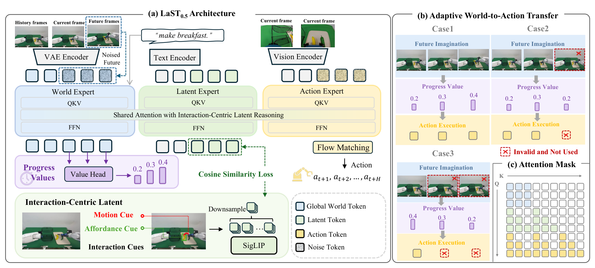

# LaST0.5: A Generalist World Action Model with Interaction-Centric Latent Reasoning

世界模型擅长预测整幅画面的变化，操作策略却需要知道手与目标如何接触。LaST0.5 在视频预测和动作生成之间加入交互潜表示，用离线构造的轨迹、目标框监督它，再通过预测进度选择动作块的执行前缀。[arXiv:2611.14048v1](https://arxiv.org/abs/2611.14048)。这篇论文于北京时间 11 月 10 日提交，本笔记为补充窗口精读。

## 从未来画面提取交互目标

一次推理从历史主视角画面、当前多视角观察与指令开始。Cosmos-Predict2.5-2B 世界专家预测十二帧未来；Janus 初始化的潜专家用可学习查询并行生成三段交互潜变量；独立参数的动作专家通过流匹配预测动作块。三者共享注意力流，分块因果掩码让某段动作只直接访问对应或更早的视频和潜表示。世界专家的键值停止接收下游梯度，避免动作目标直接改写这部分预测上下文（第 3–5 页）。

*左侧是世界、潜表示、动作三个专家及监督目标，右侧说明不同预测进度下保留哪些动作段。注意力掩码维持时间段之间的读取关系。*

交互目标来自训练示范的未来画面。作者投影示范末端轨迹形成二维曲线，用 Grounding DINO 获得候选框，再在夹爪开闭事件附近匹配目标物体。带曲线与框的图像由冻结 SigLIP 编码，经可训练聚合和投影形成监督向量。这些标注在训练前生成；部署时只输入学习后的查询，不需要真实未来画面或在线画框。

潜专家学习的核心目标是
$$
L_{\mathrm{lat}}=1-\frac{1}{M}\sum_{i=1}^{M}\cos(\hat z_i,z_i^{GT}).
$$
这里 $M$ 是时间段数，默认三段；$\hat z_i$ 是潜专家输出，$z_i^{GT}$ 是带交互提示画面的目标向量。余弦对齐让潜表示偏向与操作有关的视觉结构。训练还保留世界模型生成损失和动作流匹配损失。它监督了交互表示的方向，不能仅凭该损失认定模型恢复了完整接触物理。

## 进度下降时如何重规划

联合训练后，模型被冻结，额外训练轻量进度头。每四帧未来对应一个池化后的特征和进度值。目标来自示范时间 $v_i^{GT}=t_i/T$，其中 $t_i$ 是对应帧组的中间时刻，$T$ 是整回合长度。倒序或重复帧增强为下降、停滞的目标序列提供训练样本（第 5 页）。

执行时只保留预测进度持续增加的动作段。一旦后续值下降，就截断该段之后的执行，重新观察。如果初始预测值已低于上一周期的进度，则并行采样多个世界未来，选值最高的候选，把其键值缓存交给潜专家与动作专家。时间对齐使“放弃后半段未来”能对应到具体动作前缀。

这个头预测的是由演示时间监督得到的进度代理。我的分析是，它仍可能受停顿、重复动作或非单调任务阶段影响。论文中的成功率消融支持这套执行规则在已测任务有效，尚不能把进度递增当作物理安全或视频正确性的保证。

## 成功率需要结合协议阅读

预训练数据超过 14,000 小时，来源异构。LIBERO 数字取训练期间最佳成功率；十项 RLBench 每项每轮二十次、三轮，报告均值与标准差。两套口径要分开（第 6 页）。

| 设置 | 不使用 AWAT | 完整 LaST0.5 |
| --- | ---: | ---: |
| LIBERO 平均成功率 | 99.2% | 99.5% |
| 十项 RLBench | 85.0 ± 2.0% | 88.0 ± 3.0% |

LIBERO-Spatial 的基础模型为 99.6%，移除潜专家降至 97.8%；保留潜专家但取消轨迹和目标框监督为 98.6%。这些是接近饱和区间的差距，不能只从注意力图推断因果贡献。附录中三、六、十二个潜表示单元 分别为 99.6%、99.4%、99.3%，增加容量没有持续改善；并行生成与自回归接近，直接用真实潜目标训练的教师强制版本较差（第 14 页）。

天玑 Marvin 四项双臂实机任务各二十次，完整任务平均成功率为 63.8%，π0.5 为 52.5%。装箱和螺丝任务还报告分阶段成功，最终平均使用完整完成，不能混用阶段指标。物体位置偏移下，两项任务平均 40.0%，换物体为 55.0%，换背景为 72.5%（第 7–8 页）。

附录明确展示拉链卡住、篮子碰移、胶带打滑和螺丝毫米级错位等失败。交互监督改善了学习落点，视觉表征仍不足以消除精密接触与执行器限制。复现时应固定检查点选择规则，单独比较交互监督与执行前缀规则，并补充暂停、进度倒退和实际推理成本测试。

## 参考资料

- [论文与版本时间](https://arxiv.org/abs/2611.14048)
