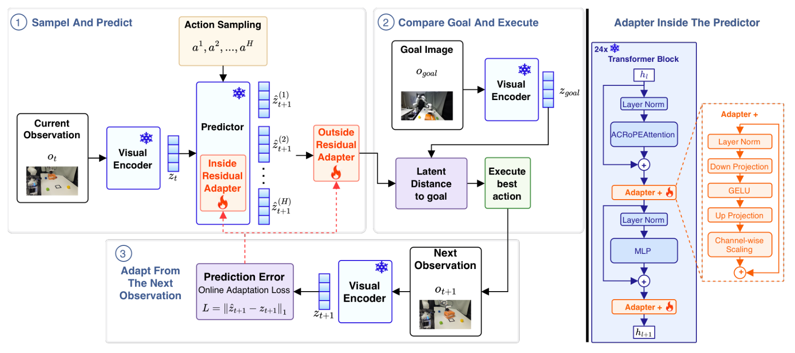

# Few-Shot Residual Adaptation of Pretrained Latent World Models

相同推箱任务中，仅改变重心或摩擦就可能破坏世界模型规划。本文固定预训练模型与控制器，用部署时三回合交互学习内部和输出两处残差，让规划继续使用被修正的预测。[arXiv:2611.13592v1](https://arxiv.org/abs/2611.13592)。北京时间 11 月 10 日提交，本期补记。

## 在预测器内部和输出处纠偏

基础 DUET-DINO 从侧视与腕部相机读取图像，用冻结 DINOv3 编码成 patch 潜变量，经过跨视角信息交换与动作条件预测，输出下一时刻潜状态。每个视角预测头有二十四个 Transformer 块。夹爪在推箱过程中始终关闭，控制器只搜索实际可变的动作维度（第 3 页）。

*候选动作经过修正后的预测器，与目标图像的潜表示比较；实际执行后的下一观察形成自监督目标。右侧展开内部 Adapter+，同时保留输出残差路径。*

内部 Adapter+ 在两个预测头的每块插入两次，共九十六个模块。对隐藏向量 $h$，修正为
$$
h'=h+c\odot W_{\mathrm{up}}\operatorname{GELU}(W_{\mathrm{down}}\operatorname{LN}(h)).
$$
$W_{\mathrm{down}}$ 将 1,024 维降到 128 维，$W_{\mathrm{up}}$ 恢复宽度，$c$ 是逐通道学习的缩放。原参数冻结，残差支路改变中间计算。输出再经过两视角共享的逐位置 MLP；该 MLP 只读预测特征，不直接读取上一状态或动作。上投影和输出末层零初始化，使初始修正为零。

两处新增约 29.2M 参数，占冻结预测器 4.53%。规划保持单步 CEM：采样候选动作，预测双视角潜状态，以到目标编码的距离排序，两轮 CEM 后执行提议均值。模型的修正会改变排序依据，但控制器算法未变。

## 三次交互怎样用于自监督训练

执行获得的真实下一观察由冻结编码器处理，成为目标。对侧视、腕视两个视角 $v$，预测损失的基本形式为
$$
L_{\mathrm{pred}}=\sum_v\|\tilde z^v_{t+1}-z^v_{t+1}\|_1,
$$
其中 $\tilde z$ 是双处修正后的预测，$z$ 是真实下一帧编码。训练不需要奖励，也不估计具体摩擦或重心参数。时间序列以 4Hz 抽样，潜变量缓存进回放缓冲区（第 4 页）。

每个适配回合结束后，先更新内部模块二十五步，结合教师强制和两步自回归误差；然后冻结内部模块、重新计算预测，再更新输出 MLP 二十五步。内部批次为八段八帧序列，外部最多二百五十六个转移。三回合后两处残差都冻结，随后评测。顺序训练与同时联合更新是不同方案，不能混记。

真机三回合共二十四帧，仿真为七十五帧。少量数据不意味着实时：RTX 4060 Ti 上每控制步端到端约二十八秒。它展示固定场景的少样本恢复，尚不适合直接解释为高频在线机器人控制。

## 预测改善为什么仍可能控制失败

任务要求箱子至少一半越过目标线且朝向变化不超过约二十五度。真实平台为 DROID 配置 Franka，重心偏移通过隐藏重物构造，摩擦偏移通过部分轨道铺布构造；后者视觉上可见。仿真没有忠实重现分区摩擦，故只测重心变化（第 4–5 页）。

| 真机设置 | 冻结模型 | LoRA | 顺序双处残差 |
| --- | ---: | ---: | ---: |
| 重心偏移 | 0.0% | 30.0% | 90.0% |
| 摩擦变化 | 3.3% | 66.7% | 100.0% |

每个真机实验三十次；全量微调在摩擦变化下也达到 100%，该条件并非独有优势。仿真三种适配种子、每种五十次，双处残差为 56.7 ± 13.3%，联合训练为 44.0 ± 6.0%，最佳内部单处 LoRA 为 32.7 ± 9.0%。这些对照支持修正位置与训练顺序的重要性。

更关键的诊断使用同一单适配种子的五十次测试：名义动力学训练的适配器能消除大部分与偏移适配器共同的预测误差，却在重心偏移下只有 6.0% 成功，专门适配后为 72.0%。总体预测误差下降不足以解释控制恢复。偏移适配器回到原任务只有 54.0%，低于冻结模型的 85.3%；仿真到真机迁移为 0%，反向迁移也很差（第 6 页）。

作者因此将其定位为部署条件特定的纠偏，未识别残差究竟编码了哪一物理量。我的分析是，复现必须保留控制成功与潜空间误差两组指标，并测试原条件回退、跨域和执行成本。只测预测损失，可能选出不能正确排序候选动作的适配器。

## 参考资料

- [论文与版本记录](https://arxiv.org/abs/2611.13592)
