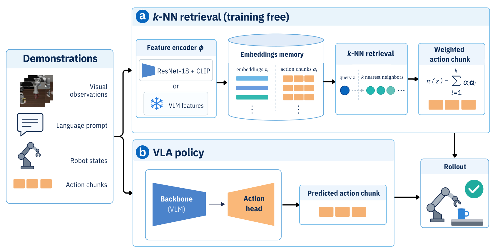

# How Much of Your VLA Is kNN

在示范覆盖密集的机器人基准上，成功率可能同时反映表示学习、动作插值和任务泛化。这篇论文把近邻检索直接变成控制策略，用它衡量公开 VLA 的成绩有多少可以从示范中恢复。[arXiv:2611.13160v1](https://arxiv.org/abs/2611.13160)。北京时间 11 月 10 日提交，本期补记。

## 先把示范变成可执行记忆

离线阶段从 LIBERO 的 1,693 条示范每隔一帧存一个观察、后续动作块和源轨迹编号，得到约 137,000 条记忆。基本视觉键来自冻结 ImageNet ResNet-18 的空间特征；语言使用 CLIP，机器人状态标准化。多模态距离还可以包含时间和短期观察历史，各分量按同任务距离中位数归一化（第 3–5 页）。

*上支路保存示范特征与动作块，从近邻组合动作；下支路使用 VLA 的骨干和动作头。两条支路都进入闭环执行，因而可比较成功率。*

查询观察编码后，选择距离最近的 $k$ 个记忆，并限制每条源示范最多贡献一个邻居。这样邻居不会全部来自同一轨迹的相邻帧。输出为
$$
\pi(q)=\sum_{i\in N_k(q)}\alpha_i a_i,\qquad
\alpha_i=\frac{\exp(-d(q,i)/\tau)}{\sum_{j\in N_k(q)}\exp(-d(q,j)/\tau)}.
$$
$q$ 是当前查询，$N_k(q)$ 是选中的记忆集合，$a_i$ 是该记忆后续的动作块，$d$ 是归一化多模态距离，$\tau$ 为温度。每个时间位置的动作做加权平均，所以执行器仍收到整块连续动作。该机制只能组合已有动作，不能自然外推到记忆未覆盖的解法。

最简单版本按任务限制检索，只用图像距离，$k=8$ 并执行整个动作块。多模态版本从全部示范检索，$k=13$，加入主动作模式选择和时间集成，每步重规划。两者无需额外策略训练，但使用了已有视觉预训练；距离权重和超参数经过调优。第三种 LAC 键版本另训练线性投影，不属于完全免训练版本。

## 局部动作一致性怎样计算

仅看视觉距离，无法知道相近图像是否需要相近动作。作者用保留查询的未来动作作为离线参照，把近邻动作均方误差与同任务记忆的平均误差比较：
$$
\operatorname{LAC@k}(q)
=1-\frac{\frac{1}{k}\sum_{i\in N_k(q)}\|a_q-a_i\|_2^2}
{\frac{1}{|C(q)|}\sum_{j\in C(q)}\|a_q-a_j\|_2^2}.
$$
$a_q$ 为查询的真实未来动作，$C(q)$ 是同任务记忆集合。邻居比一般同任务匹配更准确时，分式较小，LAC 较高。它因此衡量“表示空间的局部性是否具有动作意义”，需要动作标签，不能仅凭未标注部署图像计算。

论文报告 LAC@8。排除在保留示范上已训练的微调骨干后，它与闭环检索成功率的 Pearson 相关为 0.78，Spearman 排序相关为 0.61，不能可靠区分相近质量的键。用可微代理训练线性投影可改善检索，但诊断相关性不等于完整控制评价（第 4、7 页及附录）。

## 检索成绩与泛化之间的边界

LIBERO 四套共四十项任务，每项五十次、每策略共二千次。LIBERO-Plus 使用固定四百二十个变体，涵盖七类扰动，各策略使用相同子集。公开 VLA 按其发布配置执行，成绩可能不同于原论文（第 4–6 页）。

| 策略 | LIBERO | LIBERO-Plus |
| --- | ---: | ---: |
| 视觉 ResNet 近邻 | 88.7% | 75.5% |
| 多模态近邻 | 91.7% | 82.4% |
| 训练 LAC 键的近邻 | 93.0% | 81.7% |
| π0.5 | 97.7% | 85.5% |

多模态近邻的跨基准下降为 9.3 个百分点，少于本次其余对照，但绝对成功率仍低于 π0.5。只保留一成示范使其降到 77.4%，原始像素检索为 57.2%，移除语言降低 27.1 个百分点；若只移除时间集成、状态、历史或模式选择，单项差距不超过约一个百分点。数据覆盖和表征是主要因素，复杂执行修饰的收益较小。

用 VLA 骨干代替视觉键时，八个微调骨干中七个在 Plus 上改善检索；π0 是重要反例，其 LIBERO 检索由 86.9% 降至 17.9%。动作分析也显示很多 VLA 输出接近训练动作，但这些相似性是行为层面的观察，不能证明神经网络内部只有查表。

作者明确限定在 LIBERO 及相关扰动。其示范密集，扰动多保留原任务和解法轨迹，未测任意新轨迹或真实机器人的广泛泛化。可复用结论是把近邻、数据量和固定动作协议加入基线，同时设计需要新解法的测试，而非用本结果否定所有 VLA 的泛化能力。

## 参考资料

- [论文](https://arxiv.org/abs/2611.13160)
- [作者评测代码](https://github.com/sereact/lerobot_knn)
