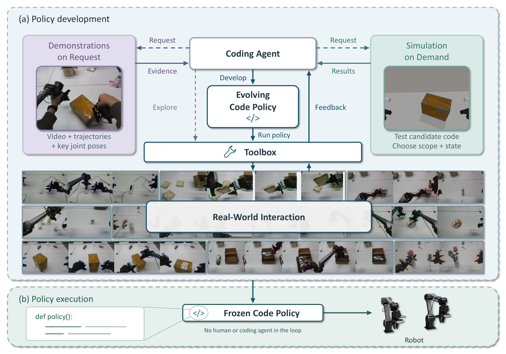

# ACE-CaP-0: Real-World Code-as-Policies in the Era of Experience

反复让大模型决定机器人下一动作会产生推理等待。ACE-CaP-0 把模型的作用集中到开发阶段：通过真机反馈、按需示范和有针对性的仿真修改程序，最后冻结任务逻辑，让程序继续读取实时感知并执行。[arXiv:2611.16872v1](https://arxiv.org/abs/2611.16872)。北京时间 11 月 12 日提交，本期补充窗口精读。

## 把经验请求变成程序开发的一部分

开发工件是可执行策略，包含动作次序、几何计算、运动参数与夹爪命令。编码代理从任务指令和机器人接口开始，面对未决问题，可以修改代码、请求示范、构造仿真或直接试真机。经验获取因此与程序修订相互影响，而非固定先做一次完整示范再训练（第 3、7–8 页）。

*两侧的示范和仿真向中央程序开发循环提供证据，底部的执行阶段使用冻结代码，通过机器人接口响应运行时观察。*

示范由人牵引机器人双臂，提供视频、手臂轨迹和关键关节姿态。代理结合物体交互与动作参考，确定抓握配置、接近方向和双臂分工，再将其编码成程序。示范提供可行线索，具体接触和几何仍需试验。这里不应把“无运行时人工”误写成“开发过程不需要人类经验”。

## 仿真结论如何回到真实机器人

仿真实验针对当前问题选择任务片段、起始条件和候选代码，必要时新建或修改模拟器。路径避障比较与接触行为比较所需的物理精度不同；程序若读取图像、深度，还需要检查模拟观察与真实传感器的可用性。仿真筛选后回到真机，若结论失效，重新检查程序和模拟假设（第 6–9 页）。

插充电器的对照中，按需仿真最终真机成功率为 100%，真实反馈单独开发为 86.7%；开发时间由 3.7 小时降至 2.6 小时，但输出量从 0.73M 增至 1.09M。顺序“真机—仿真—真机”版本为 0%，失败发生在抓插头阶段：干净模拟图像和没有真实近距离盲区的深度，诱导程序依赖部署时不可靠的感知。

这个失败支持持续检查观测假设的重要性。由于六种开发条件每种只运行一次，且集中于同一任务，不能据此证明仿真优劣的普遍排序。它更像有成本记录的开发案例。

最终策略被冻结，运行时仍调用感知和控制，固定规则会根据新观察计算不同参数和动作。因此“冻结”指程序决策规则不更新，不是完全开环重放，也不是所有感知模块都停止计算。

## 成功率、开发成本与可重复性

双 Agilex PIPERX 与三路 Orbbec 相机用于八项任务。开发代理为 Claude Opus 5.5，每任务最多十次人工协助场景重置；示范采集的重置不计入此预算。程序开发结束后，每任务另外三十次真实试验，期间不再改代码（第 10–11 页）。

| 任务组 | 成功情况 |
| --- | --- |
| 插充电器 | 30/30 |
| 装面包 | 25/30 |
| 其余六项 | 各 27–29/30 |
| 全部八项 | 221/240，92.1% |

各任务平均物理执行时间为 0.97–2.27 分钟。这没有包含数小时的开发、示范和模型推理总开销。开发输出量随任务约为 0.75M–2.14M，也不等同于完整计算费用。论文提出未来应把示范人工成本纳入账本。

三十次冻结评测说明所得到程序在这些场景中的可靠性，未测独立重复开发是否得到同样强的程序，也未证明新任务或新物体下不需再开发。复用可先保留程序版本、开发重置与示范预算、仿真假设和独立评测集，再比较经验请求策略；否则很容易把较多开发投入产生的收益误归给某个代理配方。

## 参考资料

- [论文](https://arxiv.org/abs/2611.16872)
