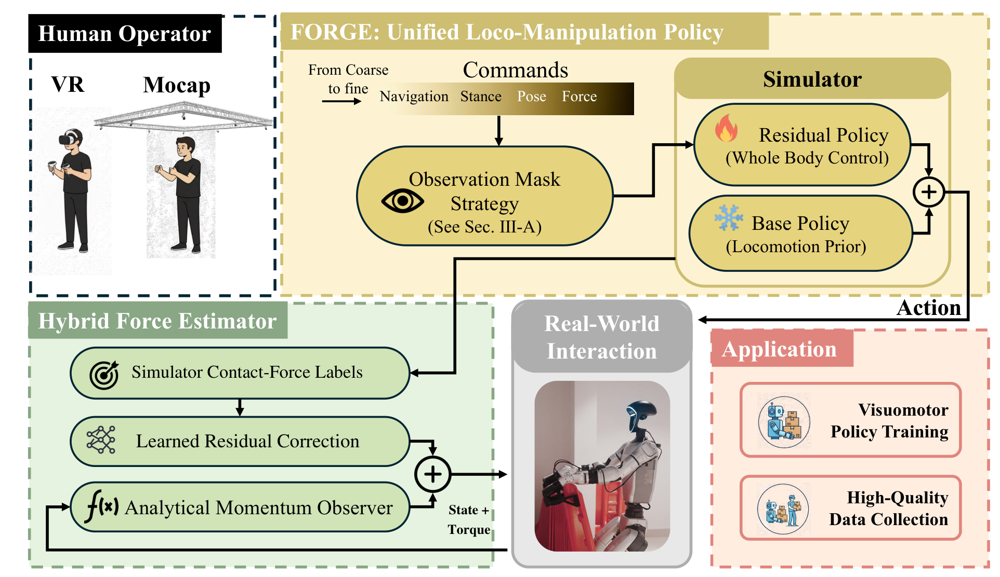

# FORGE: Force-Aware Multi-Granularity Control for Efficient Humanoid Loco-Manipulation

人形操作既需要走到目标附近，也需要稳定足位、精细腕姿态与持续接触。FORGE 用一套多粒度命令接口驱动同一全身策略，并从关节信息估计低频腕等效反力，以虚拟目标调整接触。这里讨论的是[人形控制论文](https://arxiv.org/abs/2611.17142)，不是同名的早期装配方法。

## 把粗导航和精细腕部指令放在同一接口

导航速度、平面足位置、双腕姿态和可选期望施力分别有激活位。未启用的命令既从观察中屏蔽，也不计相应奖励，避免旧目标与当前任务竞争。六帧可观察历史经共享 MLP 和两层 Transformer，另有适配编码器提供潜变量，动作头输出二十九维关节命令，运行频率为 50Hz（第 3–5 页）。

*冻结的行走先验与残差一起控制机器人；仿真力仅用于训练修正，部署反馈来自状态与重建力矩。*

下肢十五维使用冻结行走专家加残差，上肢十四维由新策略直接控制。下肢探索标准差限到 0.2，上肢允许更大探索。这样仍能为操作调整姿态，又减少重新学习步态时的不稳定。训练不需要完整人体关节轨迹，但仍需要先验策略、仿真任务和稀疏腕部及粗运动命令。

## 无腕力传感器怎样调整接触目标

解析动量观测器从双臂状态和由目标位置重建的 PD 力矩估计扰动力矩，再用腕部平移雅可比投影为三维腕等效反力。它采用手臂子模型，未完整消除浮动基座、腿、腰与双臂耦合；学习残差用仿真接触力监督，补偿可重复误差。部署不读取仿真真值或腕力传感器（第 4 页）。

最终环境反力估计为 $\hat f_{\mathrm{env}}=\hat f_{\mathrm{obs}}+\Delta f_\theta$。期望机器人施力 $f_{\mathrm{cmd}}$ 与环境反力方向相反，因此误差是 $e_f=\hat f_{\mathrm{env}}+f_{\mathrm{cmd}}$。虚拟腕目标为
$$
p_{\mathrm{virt}}=p_*+K_f^{-1}e_f.
$$
$p_*$ 是名义腕位置，$K_f$ 单位为 N/m，其逆将力偏差转成位置偏移；平衡时两力抵消，偏移归零。两腕分别计算后交给同一个全身策略。估计值经平滑并限到五十牛，论文特别说明这不是对最终虚拟位置单独施加硬裁剪。

腕等效力是“能通过雅可比解释观测扰动的平移力”。非腕接触和全身耦合没有被独立识别，故适用范围是低频、准静态持续接触，不能把它当作任意碰撞的精确力传感。

## 跟踪、接触和下游成功分别检验

同机器人同目标序列、每方法二十次，FORGE 腕部平均位置误差为 4.15cm、足部为 5.42cm。表中的二十二毫秒延迟定义为指令发出到末端到达目标，不是神经网络前向耗时。刚盒双腕接触的平均挤压力 8.52N 是另一项仿真比较，不能与硬件跟踪合成同一指标（第 5–6 页）。

力计同步加载每条件十次。代表性分级载荷轨迹的混合估计 RMSE 为 x 轴 0.81N、y 轴 1.97N、z 轴 0.87N；三十五、四十、五十牛未见垂直载荷下增至 8.28、9.66、12.35N。论文支持测试范围内的改善，也显示外推误差增长（第 7–8 页）。

下游扩散策略以每载荷八十条示范训练同一跨载荷策略，空载、0.5kg、1kg、2kg 的箱体运输成功率分别为 100%、100%、90%、90%，每种二十次。泡沫盒对照中，启用反馈减少可见形变，但两种设置都能完成举起，尚无普遍损伤概率结论。复现时需分别报告稳定性、接触误差、任务成功和接口延迟，核对力矩代理及接触点假设。

## 参考资料

- [arXiv:2611.17142v1](https://arxiv.org/abs/2611.17142)
- [作者项目页](https://bb0928.github.io/forge/)
