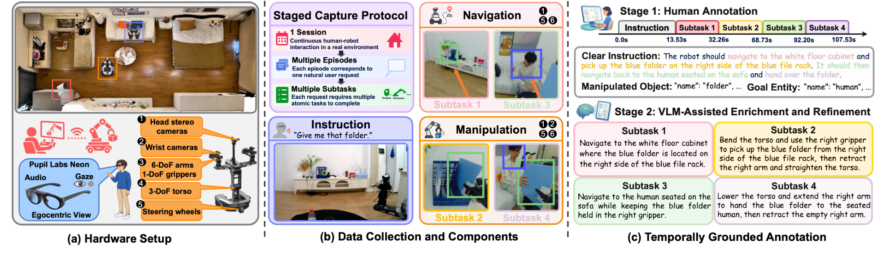

# HEIR: Harness Egocentric Intent for Human-Robot Interactions

机器人看到的场景可能不足以解释“把那个递给我”。HEIR 同步记录人的第一视角、语音与注视，以及机器人观察和遥操作，保留连续会话内的请求和执行结构，用于连接意图解析、子任务规划、导航和操作。[arXiv:2611.17238v1](https://arxiv.org/abs/2611.17238)。

## 把请求、会话和执行子任务对齐

数据分为会话、请求级回合和执行子任务。一个请求可以交替包含导航与操作，一个操作子任务又可能涉及多个物体或双臂。名义计划表示执行前可推断的任务结构，实际子任务序列保留可达性或姿态调整造成的差异，不能混为同一标签（第 4–6 页）。

*左侧记录人的眼动眼镜与机器人多相机，中间保留连续请求及导航操作，右侧区分人工边界和 VLM 语义增强。*

Neon 眼镜记录第一视角、声音与注视，Galaxea R1 Lite 提供四路图像及双臂、夹爪、躯干、底盘状态。另一名操作者遥操作机器人，故采集轨迹不是模型自主执行记录。起止秒表读数定义线性时间映射，将人类视频、音频与注视对齐到机器人 30FPS 时间轴。

人工首先标请求证据、意图对象与目标、实际执行边界；GPT-5.6 在保持边界和次序的前提下补充子目标与完成条件，再人工检查。导航参考融合 MapAnything 与轮式里程计。外部验证中的 8.55cm 平面位置 RMSE 来自一段 16,323 帧录像，Tracker 到底盘变换在该录像上拟合，不能把它当独立绝对定位测试。

数据包含十七名参与者、三百会话、38.56 小时、1,836 个请求和 6,416 个子任务。二百四十会话用于训练验证，六十用于测试；发布说明明确是按会话而非参与者隔离。评估用户泛化还需要新的划分。

## 四层评价如何接成闭环

意图解析读取语音、时序人类画面与注视、机器人视角和会话历史，输出对象、地点、目标与名义计划。子任务规划器随后按当前观察在 Continue、Switch、Done 中选择；Switch 还须给出类型、子目标与完成条件，再路由到导航或操作后端（第 6–9 页）。

指标分工很重要：对象槽位 F1 和位置准确率测语义落地；Plan EM 测导航操作阶段的严格序列匹配；规划 Core 和 Completion F1 依赖盲化文本语义评审与固定参考事实，错误决策或类型被计零。评审不从视觉判断左右手可达性。离线动作误差又是另一层，不能把这些分数直接解释成闭环任务成功。

Gemma-4-31B 的受控消融中，人类加机器人视角的位置准确率为 71.13%，叠加中心先验为 71.39%，真实注视为 77.69%；完整输入的计划精确匹配为 78.11%。中心先验控制有助于区分真实注视与画面中心偏好，但收益仍受模型、输入与评分协议限制（第 8 页）。

## 意图指标提升为何不等于任务完成

真实系统从意图、规划再到导航和操作逐层积累误差。导航在三十二个子任务上的成功率为 81.25%，完整请求在二十七回合上仅为 18.52%。另有二十项抓放任务各三次的操作模型比较，Lingbot-VLA2 为 68.33%、FastWAM 为 60.00%、π0.5 为 36.67%；该子集排名不能证明离线动作误差是普适闭环代理（第 10 页）。

| 证据 | 能支持的解释 | 仍需验证 |
| --- | --- | --- |
| 注视与中心先验消融 | 已测模型的意图解析可利用注视 | 其他用户、环境和设备 |
| 操作离线误差与三模型真机排名 | 小规模子集排名一致 | 更广泛模型的可靠代理关系 |
| 27 回合整请求 | 集成系统仍有长程失效 | 更大样本及闭环注视因果贡献 |

附录中的注视示例是有限定性案例，未以可比的完整会话重复隔离因果效果。数据资源当前能核验的发布包含三百份处理后标注；本期没有完整下载核对全部视频与状态动作流。复用时先确认具体媒体权限、标注与原始流的版本对应，再固定会话历史、评分器和训练划分。这个资源的主要价值是让不同层级的成功与失败可以被共同研究，尚不能由高离线分数认定自然家庭协作已解决。

## 参考资料

- [论文与附录](https://arxiv.org/abs/2611.17238)
- [发布的标注数据页](https://huggingface.co/datasets/Anonymous-HEIR123/HEIR-Dataset)
