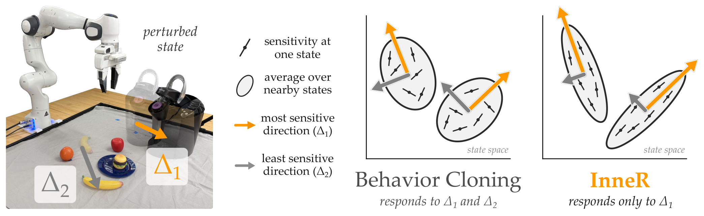

# Inner Product Regularization for Imitation Learning

策略应该对目标物体变化作出反应，同时忽略无关物体。单纯降低每个状态的敏感度，会一起压低有用反应。InneR 改为约束相近功能状态共享“不影响动作”的扰动方向，把这个几何目标加入模仿学习损失。[arXiv:2611.17159v1](https://arxiv.org/abs/2611.17159)。

## 从动作变化找到应忽略的方向

考虑可微策略把 $n$ 维状态映到 $m$ 维动作，$n>m$。在足够小的状态扰动 $\Delta$ 下，动作变化近似为 $J(s)\Delta$。$J$ 是对状态的策略雅可比。若动作差异用正定矩阵 $M$ 加权，状态中的内积矩阵为
$$
A(s)=J(s)^\top M J(s).
$$
因此 $\Delta^\top A(s)\Delta$ 测量该扰动引起的一阶动作变化，零空间包含一阶不敏感方向（第 4–5 页）。这要求局部近似有效，不能直接推广到大幅状态跳变。

*咖啡机位置应影响关盖动作，香蕉位置不应影响它。右侧椭圆示意各状态的敏感方向，InneR 希望共享无关方向，而保留对目标的反应。论文无独立网络管线总览，本图为核心机制概念图。*

各 $A(s)$ 均为半正定矩阵，所以它们平均矩阵的零空间等于各自零空间的交集。若平均后仍有足够大的零空间，相关状态就共同忽略一组扰动。直接惩罚整个雅可比范数只缩小响应，并不要求这些方向在不同状态一致；InneR 因此只处理平均矩阵的尾部谱。

## 在局部区域正则化共有零空间

任务不同阶段可能关心不同对象，不能要求整个数据集共享一个无关子空间。每批训练中先计算雅可比行空间，再用投影矩阵的 Frobenius 距离找行空间最对齐的 $k$ 个状态，形成每个状态的局部区域。这里的“附近”按功能方向定义，不必在欧氏位置上接近（第 8–9 页）。

对区域平均矩阵的特征值按从大到小排列，正则项使用
$$
L_{\mathrm{InneR}}
=\frac{1}{B}\sum_{i=1}^{B}
\frac{\sum_{j=m+1}^{n}\lambda_j^i}
{\operatorname{sg}(\sum_{j=1}^{n}\lambda_j^i)}.
$$
$B$ 是批次中的区域数，$\lambda_j^i$ 是第 $i$ 区域平均矩阵的特征值，sg 表示分母停止梯度。尾部之和衡量共有零空间还残留多少敏感响应；总谱归一化使不同尺度可比较。它不直接惩罚前 $m$ 个方向，原模仿目标继续约束有用动作。

随机策略改用输入状态的 Fisher 信息矩阵，允许指定有效秩 $r$ 替代 $m$。固定协方差高斯策略可以精确化为均值雅可比的加权内积；扩散策略则从去噪损失的 ELBO 梯度近似分数，再对采样动作求外积。有限采样带来额外半正定偏差，梯度估计和高阶求导也增加训练成本，不能把该近似当作精确 Fisher。

## 实机收益与噪声边界

论文实验输入为可读取的状态向量，尚未研究端到端图像空间正则。实机使用 Franka 与 UMI 夹爪，RGB-D 分割跟踪提供物体位姿。关咖啡机、叠方块、推锅分别采集二十五、五十、二十五条示范，再进行旋转、镜像扩增。各方法共享数据、架构、训练配置与测试条件，每任务每条件二十次（第 14–15 页）。

| 三任务平均 | 行为克隆 BC | InneR |
| --- | ---: | ---: |
| 无干扰物 | 73.3% | 75.0% |
| 三个干扰物 | 18.3% | 56.7% |
| 合并上述两种条件 | 45.8% | 65.8% |

摘要的“18% 到 57%”对应三干扰物条件。无干扰时接近持平，说明不应把改善写成所有设置都增加约三十九个百分点。核范数对照即使无干扰也只有 25.0%，反映过强收缩可能损伤控制能力。

关咖啡机并带三个干扰物时，额外一毫米观察噪声下 InneR 为 50%，BC 为 20%；一点五毫米为 40% 对 10%。到两毫米时 InneR 与核范数方法都失败，论文只部分支持抗噪声假设。仿真也存在扩散策略与 BC 接近、另一变体更好的设置。复现应同时测成功率、相关与无关方向的选择性、训练计算，以及不同噪声幅度，保留局部几何假设的适用范围。

## 参考资料

- [论文](https://arxiv.org/abs/2611.17159)
- [作者项目页](https://collab.me.vt.edu/inner/)
