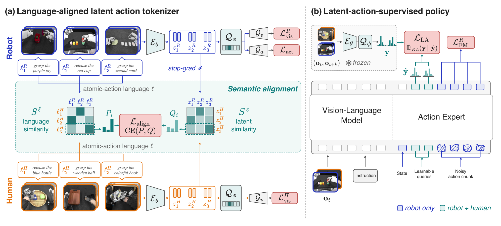

# SALA: Semantically Aligned Latent Actions Enable Dual-Axis Scaling of Embodied Foundation Models

人类视频没有机器人动作标签，潜动作模型可以用相邻画面提取变化，但只重建画面也可能把背景编码成“动作”。SALA 用语言描述建立未配对人类、机器人片段的软对应，并用真实动作把机器人潜表示锚定到控制，再让人类视频监督同一个动作专家。[arXiv:2611.17110v1](https://arxiv.org/abs/2611.17110)。

## 用语言邻域约束潜动作对应

标注器读取相隔一定步长的两帧，由逆动力学编码器推断潜动作，经 SoftVQ 压缩后，与当前画面共同重建未来 DINOv2 特征。机器人片段另外提供初始状态和动作块，训练动作解码器；人类片段没有这个分支。两类片段共用视觉编码器、量化器和视觉解码器（第 3–5 页）。

*左侧先以机器人动作重建约束控制语义，再用语言相似度约束跨本体邻域；右侧冻结标注器，将其软分布作为策略的额外目标。*

对人类片段 $i$，原子动作描述与批次内各机器人描述的相似度，经 softmax 得到分布 $P_i$；人类潜变量与机器人潜变量的相似度得到 $Q_i$。对齐目标为
$$
L_{\mathrm{align}}=\mathbb E_i\,\mathrm{CE}(P_i,Q_i).
$$
这里 CE 是交叉熵，两个分布均在机器人候选维度归一化，温度控制邻域的锐度。潜相似度计算中，机器人向量停止接收这个损失的梯度，使人类表征向动作监督锚点靠近。停止梯度只针对这条对齐路径，机器人表示仍接受视觉与动作重建训练。

SoftVQ 每个位置输出码本上的类别分布，并按权重组合码字，使相近语义可以连续移动。实验使用八个潜表示位置、二百五十六码字。硬 VQ 的单码选择难以表达这种渐变，论文观察其对齐损失几乎不下降，虽然视觉重建相近。语言标注是对齐监督，不能据此认为模型无需语义注释。

## 冻结教师后怎样训练动作专家

标注器训练完后冻结，用帧对产生软潜动作目标。策略本身只读取当前观察与任务指令；未来帧仅用于离线制作目标。Qwen3-VL-4B 编码视觉语言，独立的约 0.6B 动作专家同时处理潜动作查询和带噪动作。动作读取这些查询，既学习潜动作分布，也通过流匹配学习实际动作（第 5–7 页）。

人类视频预训练只使用潜动作 KL 损失；机器人中期训练叠加真实动作损失。可选任务后训练再混合任务专属人类视频与遥操作。大规模人类视频在策略阶段不需要动作或原子描述，但制作标注器的子集仍需要原子描述。部署不运行教师，也不预测像素视频。

仿真用 27,000 条 ARX-X5 视频与 2,500 条 Aloha-AgileX 完整示范，前者不提供动作。RoboTwin 2.0 五十任务每个条件每任务一百次，SALA 干净条件为 80.2%，随机条件为 48.6%。去掉对齐后为 75.5%、36.8%；双向对齐取消机器人停止梯度后为 73.5%、46.8%。这些对照比仅看跨本体检索示例更直接地检验控制收益。

## 扩数据的两种证据要分开

真实平台为 Sharpa North，动作覆盖手臂、手、躯干与颈部，共六十三维。数据包括约 888 小时机器人遥操作与最高 2,678 等效小时人类视频训练曝光。等效小时是训练预算口径，不应当作同样长的独立采集录像。四项任务包括齿轮装配、双臂倒液、插花和勺舀取，各二十次（第 7–9 页）。

| 实机方法 | 四任务平均成功率 |
| --- | ---: |
| 同架构但无潜动作的 VLA | 27.50% |
| GR00T N1.7 | 41.25% |
| SALA 完整训练方案 | 72.50% |

完整比较同时增加潜动作机制和可利用的人类数据，不能把全部差距归给对齐项。任务后训练保持遥操作数据固定，人类示范从 10% 增至 100% 时，成功率由 53.75% 增至 72.50%。这是直接的闭环扩数据证据。

人类视频预训练规模从零增至 473、1,103、2,678 等效小时的曲线测的是保留遥操作集上的关节动作 L1 误差，每设置一次运行。论文明确承认尚未验证更大规模趋势以及该曲线如何转成实机成功率。复现时应分开比较标注器对齐、策略结构和人类数据量，并将语义检索、离线误差与闭环成功作为不同证据。

## 参考资料

- [论文及版本记录](https://arxiv.org/abs/2611.17110)
