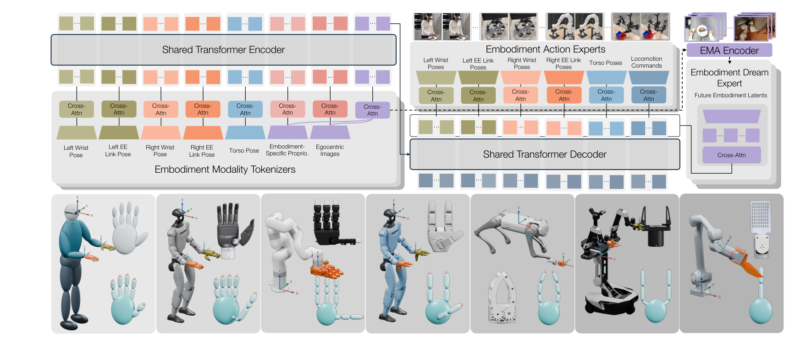
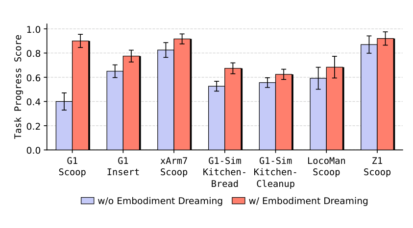

# EgoX: Egocentric Cross-Embodiment Manipulation with Embodiment Dreaming

人类、双臂机器人、四足和固定机械臂可能都在舀取物体，但它们的关节维数和相机位置完全不同。把这些数据简单拼成一个动作向量，容易让共享网络学到本体差异，而非可迁移的操作规律。EgoX 的思路是先给对应的身体部位建立共同的语义接口，再用本体专属的编码、解码模块连接共享主干；训练时还要求主干预见身体状态怎样变化。

Yaru Niu、Binghong Chen、Changwei Yao、Shangtao Li 等，CMU、Bosch、UT Arlington、UC Berkeley、NVIDIA。[arXiv:2611.16728v1](https://arxiv.org/abs/2611.16728)首次提交于北京时间 2026-11-12 20:40:24。[项目页](https://egox-dream.github.io/)链接到[代码仓库](https://github.com/egox-dream/egox)。本文笔记依据完整 37 页 PDF，包括第 19–37 页附录；没有运行代码或验证硬件表现。

## 共享的是操作语义，接口仍然属于各本体

假设输入是一帧舀取猫砂的第一视角图像，以及机械臂和末端执行器的状态。系统不会把人类指关节和机器人驱动关节直接逐维对应，而是拆出左、右腕位姿、末端关键点、躯干、图像和本体关节等模态。腕目标在第一视角坐标系表示，末端关键点在各腕坐标系表示，躯干位姿和移动速度则使用根坐标系。各平台的坐标转换必须在数据保存和推理之前完成，不能指望网络自动消除约定差异（第 5–6 页）。

每个本体的每种观察模态有独立模态编码器，动作模态有独立 expert，中间共享 Transformer 编码器和解码器。对应模态先被压成词元，共享主干进行信息融合，动作专家再输出未来一段控制目标。缺失观察可省略或置零，缺失动作不进入损失。因此，共同模态词表不等于所有本体共享全部参数，也不要求所有平台具备全部传感器。

*论文原图编号：Fig. 3。上方展示观察编码、共享主干、动作专家与 EMA 未来目标，下方展示不同身体及末端关键点；它说明迁移发生在共享主干而非统一的关节控制空间。*

可将执行链概括为 $\pi_e=\Psi_e\circ G_\theta\circ\Phi_e$：$e$ 是本体，$\Phi_e$ 编码当前观察，$G_\theta$ 为共享主干，$\Psi_e$ 把其输出还原为该本体的动作片段。最后一步依然需要逆运动学、手部重定向或移动控制器，把几何目标变成真正的驱动指令（第 27–28 页）。这是模型迁移之外不可省略的集成工作。

## 为什么预测未来潜变量，而不重建视频

纯行为克隆只要求复现示范动作，未显式要求策略理解这些动作之后身体将如何变化。MXT+ 从当前图像、本体关节和末端关节特征聚合出 8 个本体词元，与其他模态一起进入主干；额外的 dreaming expert 预测未来多个时间点的本体词元。监督目标来自同类编码器的指数移动平均副本，并停止梯度，避免直接用学生同时移动预测与目标（第 7–8 页）。

其辅助损失的核心是：

$$
\mathcal L_{\mathrm{dream}}=\frac{1}{|K|L}\sum_{k\in K}\sum_{j=1}^{L}\left[1-\cos(\hat y_{t+k,j},y_{t+k,j})+\beta\,\ell_{\mathrm{smooth\text{-}L1}}(\|\hat y_{t+k,j}\|_2,\|y_{t+k,j}\|_2)\right].
$$

$K$ 是未来偏移集合，$L=8$ 是每个时刻的词元 数，$\hat y$ 是预测，$y$ 是停止梯度的教师目标，$\beta$ 控制模长匹配。余弦项对齐方向，模长项约束尺度；这使监督在压缩表征中进行，不必生成像素视频。目标编码器按学生参数的 EMA 更新，论文使用衰减 0.999。总目标将动作模态的标准化 smooth L1 克隆损失与该辅助损失相加；动作片段末尾及预测偏移超出轨迹的部分必须屏蔽（第 8、20–23 页）。

附录给出动作跨度为 60 步、2 秒，预测偏移为 20、40、60 步，dreaming 权重 0.3；模长项权重和 batch 设置因任务而异。跨本体预训练每步从每个本体采样并累积梯度；目标本体的目标任务示范不进入预训练，之后仍用这些示范微调。部署删除未来预测专家和 EMA 教师，但**保留从当前观察聚合本体词元 的学生编码器**。因而“仅训练使用 dreaming”不能理解成删除所有新增模块。

## 进度、成功率与迁移必须分别读

数据包含 4,851 条轨迹、34.38 小时交互。评测覆盖五任务、六机器人本体的 13 个任务—本体组合，其中五种是真机、一种是模拟人形。每个真实组合各方法运行 20 次，分为 13 次分布内和 7 次分布外；模拟组合各 50 次，分别 32 和 18 次。主指标是阶段进度加完成奖励后归一化的任务进度，不是成功率（第 9、29、31–33 页）。

| 对照 | 指标与范围 | 不预训练 | 跨本体预训练 |
| --- | --- | ---: | ---: |
| MXT+ | 13 组合平均归一化进度 | 0.63 | 0.80 |
| MXT+ | 分布外平均进度 | 0.53 | 0.77 |
| MXT+ | 同批试验平均成功率 | 0.35 | 0.56 |
| MXT+ | 分布外成功率 | 0.18 | 0.52 |

成功率来自附录 A.10；ACT 和微调 π0.5 的平均成功率分别为 0.11、0.27。ACT 仅用目标任务数据，π0.5 从已有预训练权重微调，MXT+ 比较则保持下游架构和目标一致。它们不是预训练数据、参数量完全相同的等成本竞赛。分布外也只相对于目标本体的目标任务示范，其他本体的预训练数据可能包含类似物体或条件，不能称为所有训练分布之外的泛化。

## 哪些消融真正支持设计选择

数据组成消融逐步加入人类、其他机器人及目标机器人的其他任务，完整混合总体更好。dreaming 对照在七个设置上把平均进度从 0.63 提高到 0.78，成功率从 0.39 到 0.62；这些是独立于前述 13 组合平均数的实验，不应拼接成同一条提升链。

*论文原图编号：Fig. 7。每组比较有无 embodiment dreaming 的归一化任务进度，误差条为均值标准误；七组都有改善，但它不是完整成功率曲线。*

这里移除的同时包括当前本体模态编码器、预测 expert 和 EMA 教师。因此消融证明这组组件有用，尚未把“未来监督”和“新增当前状态编码能力”的贡献完全分离。粗粒度接口对照则在保留主干、token 预算和 dreaming 的条件下合并模态；预训练在若干复杂组合上反而降低其表现，模拟厨房清理甚至降到零进度。作者认为低维移动命令可能在 51 维联合动作中被淹没，但这仍是机制解释，不能由一个对照唯一确定原因（第 11–12 页）。

Scoop 上的潜空间 Gromov–Wasserstein 距离分析显示，dreaming 后十个本体对的平均距离下降 38.52%。这表示内部几何更相似；它没有单独证明表征对齐造成成功率提升，更不保证任意任务语义都已对齐。

## 复现的成本落在数据与控制接口

作者明确承认数据由团队采集、规模有限，仿真只覆盖一个本体和两项厨房任务，新本体仍需人工指定模态对应、坐标变换和控制接口。相同大小的本体 batch 也会使小数据集被反复采样，产生过拟合风险（第 13 页）。

我的分析是，复现应先验证坐标约定、末端重定向和缺失模态掩码，再扩混合数据。否则同一“腕位姿”可能代表不同物理量，主干再大也无法可靠迁移。还应同时报告成功率、阶段进度、每本体数据曝光量及新增接口成本，并增加严格未见物体与未见本体测试。论文并未证明不经示范微调就能直接控制全新硬件。
