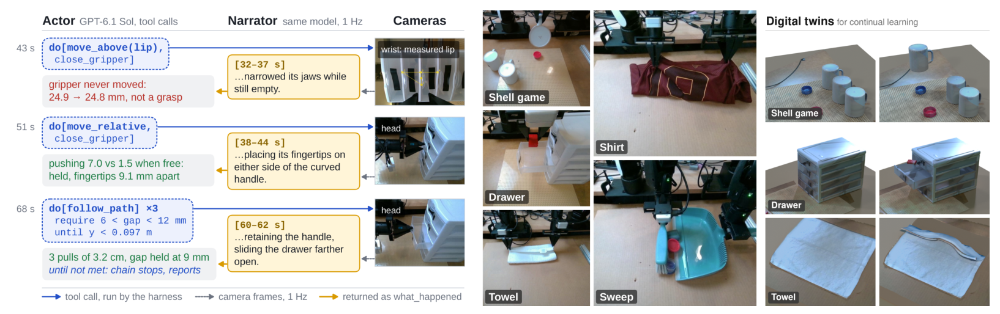
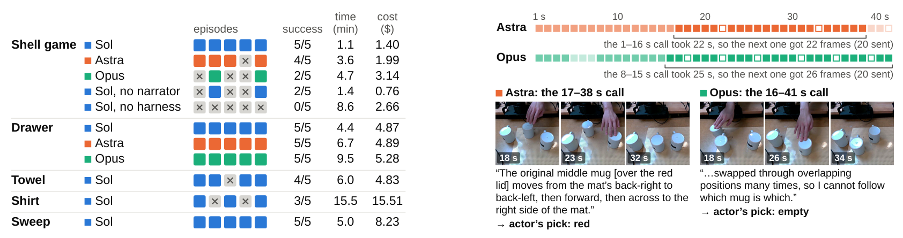

# Reins: Frontier Multimodal Models Driving Real Robot Arms on Long-Horizon Tasks, Zero-Shot

让多模态模型一次输出一段机械臂动作，最容易忽略的不是语言理解，而是物理世界在调用和思考期间仍然变化。Reins 用带检查条件的原子动作链减少模型往返，再让另一个模型持续观察并报告事件。它的核心是把可检查的反馈与决策延迟放进执行协议，而非训练一个新的动作网络。

Pengfei Ye、Zhiyang Dou、Yuxiang Ma、Haonan Chen、Heng Yang、Edward H. Adelson，MIT CSAIL、Harvard。[arXiv:2611.16632v1](https://arxiv.org/abs/2611.16632)首次提交于北京时间 2026-11-12 19:05:11；PDF 首页标注 CoRL 2026，项目页称 extended abstract。[官方项目页](https://reins-robot.github.io/)展示实验与孪生结果，论文称代码将在发表时发布；本次未确认可下载的官方实现。笔记依据完整 9 页 PDF，包含参考文献之后的 A–C 补充材料；没有运行真机或复现。

## 从“抓到了”变成能检查的物理结果

以打开抽屉为例，演员模型先通过 RGB-D 与测量工具定位几毫米宽的把手边缘，执行靠近和闭爪。一次调用返回的不只是工具执行成功，还包括指间距、电流等结果、双臂状态、新图像及最近叙述。若手指闭合后仍为空，模型可以调整横向位置，而不必沿错误抓取继续拉动。系统的 18 种工具覆盖感知、运动、夹爪、任务台账与链式调用（第 2、7 页）。

感知中的 find 使用 SAM 3 检测并登记带基座坐标的位置，measure 把像素或轮廓点变为三维点。动作包括接触停止、路径跟随和夹持反馈；接触来自关节电流，夹持主要由手指闭合宽度判断，不是完整的六维力觉。任务台账记录步骤与观察证据，仍有未完成步骤时拒绝 done，这给“结束”增加了可检查的条件。

*论文原图编号：Fig. 1。左侧三轮抽屉操作把条件、测量和事件连接起来，中间是五项真机任务，右侧为另行重建的孪生；右侧不能当作真机闭环已使用仿真规划的证据。*

do 可串接最多八个调用、总共十六次运行。每步包含工具 $p_i$、必须满足的结果条件 $\rho_i$、重复终止条件 $u_i$ 和次数上限 $n_i$。第一次结果检查不成立，或重复次数耗尽仍未达到终止条件，就停止整条链并把测量结果返回模型。比如每次拉动后检查夹爪仍保持把手，再判断抽屉是否已拉到目标位置；这与不检查中间状态的开放式动作片段有本质区别。

## 少调用模型，仍不能消除过期观察

如果每个微动作都等待模型，长程任务会被延迟支配。论文把总时长写为：

$$
T=\sum_{k=1}^{K}(\lambda_k+d_k).
$$

$K$ 是模型决策次数，$\lambda_k$ 是第 $k$ 次模型等待时间，$d_k$ 是其动作执行时间。模型延迟在实验中占总时长 41%–78%，因此每次决策覆盖多个有检查的步骤，可以减少等待次数，而不是盲目把每段动作拉得更长。

与此同时，独立 narrator 以每秒一帧接收头部图像，手臂运动时还收到腕部图像。它按连续对话报告新的事件，调用结果与演员的工具反馈合并。每次最多发送二十帧；模型上一次调用所花的时间决定下一批观察窗的跨度。第 2 页的延迟分析表明，已报告的最新帧仍落后现场约一至两次叙述调用的延迟。持续采样不等于即时理解，长窗口也不能恢复模型未可靠追踪的遮挡身份。

实现时需要保留时间戳，把“过去窗内发生的事”与“当前已测状态”区别开。模型看完叙述后仍应利用当前测量做动作检查；否则双模型结构只是把过期观察换成过期文字。后一个判断是我的工程分析，而非论文给出的无条件稳定性保证。

## 88%来自二十五回合，不是所有模型的总成绩

硬件是两台六自由度 AirBot Play、平行夹爪、头部和腕部 RGB-D 相机。每条件五次，起始为零位，操作者判断是否成功。Sol 完成五任务，另两模型只在猜杯与抽屉上比较；不能把这写成三模型均经过完整五任务评测（第 2 页）。

| Sol 完整系统任务 | 成功 | 中位时长（分钟） | 平均 API 费用（美元） |
| --- | ---: | ---: | ---: |
| 猜杯 | 5/5 | 1.1 | 1.40 |
| 抽屉放块再关闭 | 5/5 | 4.4 | 4.87 |
| 毛巾两次折叠 | 4/5 | 6.0 | 4.83 |
| 衬衫折叠 | 3/5 | 15.5 | 15.51 |
| 双臂扫物 | 5/5 | 5.0 | 8.23 |

合计 22/25，即 88%。这些费用是论文所用路由与服务档位的观测，不是本机价格估计。抽屉和扫物提示包含抓取或姿态建议，所以 zero-shot 指没有任务示范训练及任务专属代码，不代表任务知识、工具设计和标定全部不存在。

*论文原图编号：Fig. 2。左侧每格是一回合，右侧呈现叙述窗口和物体跟踪；小样本成功数、调用时延与模型能力需同时阅读。*

移除 narrator 后 Sol 猜杯为 2/5，移除 harness 后为 0/5，后者中位时间 8.6 分钟，对完整系统的 1.1 分钟约慢八倍。Astra 为 4/5、Opus 为 2/5；作者观察后者没有追踪到目标，两次成功是猜中。三模型抽屉均为 5/5。这里 Sol 使用 Ultrafast，而其他模型使用 standard，观察窗口数量与延迟也不同；结果可以说明具体系统配置有差异，不能作为固定时延、固定预算的纯模型排名。

## 上下文管理也是执行系统的一部分

第 6 页补充材料保留整段文字历史，但在距离上次压缩又增长三万词元 后，把旧图像批量替换成短占位描述，只保留最新带图轮次。物体 ID、测量点、台账和夹持记录继续存在。这样避免每次滑动窗口都修改早期提示前缀，破坏缓存。论文尝试的逐次滑窗曾把演员单次费用从 0.24 美元提高到 0.85 美元，而且没有加速。

叙述者只报告变化，连续无变化窗口合并；每六十帧重新开启对话并保留初始帧和已有事件，另有六万词元 上限。45 个计数回合中演员缓存输入比例为 88%–91%，叙述者为 56%–73%。这是特定提供商缓存规则下的系统测量，不保证其他 API 路由具有同样收益。可迁移的经验是把可持久化的物理状态与昂贵视觉历史分开，并为缓存失效保留成本记录。

## 孪生具备静态检查，不代表已验证仿真到实机闭环

附录 C 从一张标定头部 RGB 帧重建 MuJoCo 场景，按类别用参数化几何建模，以 SAM 轮廓拟合姿态和尺寸；深度来自单目网络并由桌面高度定尺度，不能把这条离线流程误写成实时 RGB-D 重建。外观用逆渲染拟合，质量和惯量由封闭网格及材料密度估计。

十四个可动物体中十一个通过门槛，包括封闭网格、碰撞几何外部误差、静置漂移、轮廓一致性及初始穿透；布料主要在静止状态检查。五个孪生中的脚本任务都可完成，但由 mocap 手执行，**不是**演员模型在孪生中自主完成；这套工具也没有用于前述真机回合。它建立了可重用场景的起点，尚未证明接触参数与现实一致，或已经带来持续学习收益。

作者承认单平台、每条件五次、接触反馈有限以及慢叙述的失效风险。我的分析是，最值得复用的是条件动作链和带时间的状态日志；最需要补测的是统一服务延迟下的模型比较、更多独立回合及真实力觉和碰撞边界。将“仿真物体通过静态门槛”和“真实操作鲁棒”合并，会掩盖这篇工作的证据层级。
