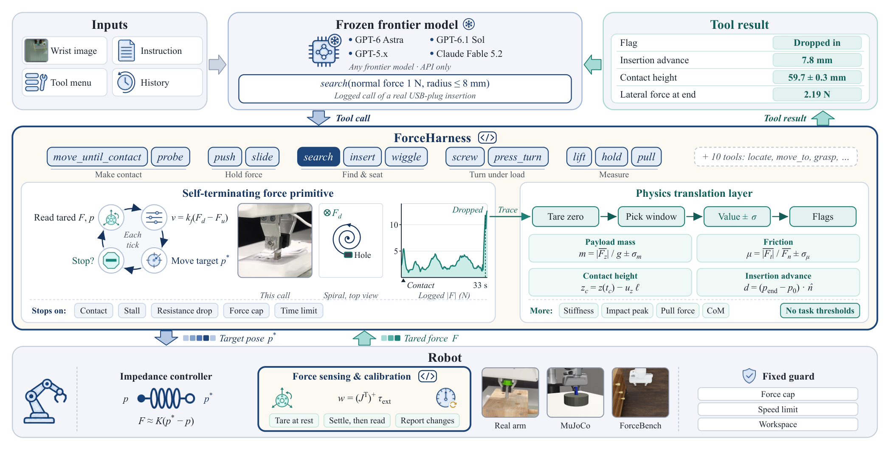

# ForceHarness: Turning Force into Action and Physics for Frozen Frontier Models

模型能看图决定“把USB插进去”，不代表它能在接触发生的几十毫秒内调力。ForceHarness把时间尺度拆开：冻结API模型选择动作和参数，机器人侧的力原语独立闭环并在接触事件终止，再把力轨迹转成有单位和不确定度的物理量返回。贡献重点在控制接口与反馈表达，不是给大模型增加一个端到端训练出的力觉骨干。

[arXiv:2611.21099v1](https://arxiv.org/abs/2611.21099v1)，首次提交北京时间2026-11-16 21:44；全文31页。第3—8页为系统及结果，附录详细列出原语、校准、提示、停止条件和对照局限。文中的“无示范和微调”指冻结模型无需更新权重，不代表系统没有人工工具设计、平台校准与任务先验；代码在文中列为发布计划，不按已验证开源实现处理。

## 慢模型怎样使用接触反馈

模型收到腕部图像、指令、工具菜单与历史，返回一次参数化调用。例如搜索插孔：向表面施加目标法向力，沿螺旋扫描，检测阻力下降后暂停搜索并尝试插入。模型不会每次控制更新都参与推理，原语自己观察力和位姿、检查停止事件、执行固定限制。

*原文图2：自终止力原语与物理量返回，慢模型不参与逐次力控制。*

原文第4页图2中，蓝色为指令路径，绿色为力与结果路径。底层校准、中层自终止原语、上层物理量转换承担不同工作：模型决定做什么和用多大目标力，原语决定何时停，独立guard限定任何模型都不能改的力、速度与工作空间边界。

没有腕部力传感器时，真实FR3根据关节外力矩估计末端wrench：

$$
w=(J^\top)^+\tau_{\mathrm{ext}},\qquad F=-(w_F-b).
$$

$J$为机器人雅可比，$\tau_{\mathrm{ext}}$为外部关节力矩估计，$+$为伪逆，$w_F$取平移力分量，$b$为静止校零偏差；负号对应作者的接触力方向约定。伪逆与关节力矩残差会受姿态、奇异性和动力学偏差影响，因此“不装腕部传感器”不等于“无需力矩感知”。论文通过动作前空手校零、动作后静止读取以及回合内比较减少漂移，而不是宣称获得了高精度绝对力传感器。

位置阻抗控制器通过目标位置$p^*$与实测位置$p$之间的超前产生近似弹簧力$K(p^*-p)$，同时限制$\|p^*-p\|\le L$。为跟踪方向$u$上的目标力$F_d$，原语使用导纳式外环：

$$
F_u=-F\cdot u,\quad v=\operatorname{clip}(k_f(F_d-F_u),-v_{\max},v_{\max}),\quad \Delta p^*=u v\Delta t.
$$

$F_u$为阻碍运动的反力，$k_f$把力误差转成速度，$v_{\max}$限速，$\Delta t$是实际控制步长。目标力不足时继续推进，过大时减速或后退；底层弹簧提供接触力，外环积分力误差。这是准静态接触控制，不应外推到高速撞击或任意灵巧手接触。

原语在接触、停滞、阻力下降、达到插入深度、力限或超时事件发生时自终止，随后将超前卸载到原来的0.1倍并静止等待。它提供move-until-contact、push、slide、search、insert、wiggle、screw等12种力原语，另有10种定位、移动和抓取工具；部分螺旋或摆动按固定超前执行，不能说所有原语每个自由度都有精确闭环力反馈。

真实系统的Polymetis关节阻抗为1kHz，guard名义50Hz，外部原语循环实测中位14.9Hz，约66ms一次，并不是API模型或Python力外环达到1kHz。固定限制包括25N原始力、3Nm力矩、8mm/s速度、工作空间边界、300ms命令年龄与15mm跟踪误差；真实实验仍有操作员急停。限值是工程边界，不是形式化的零损伤保证。

## 力轨迹怎样变成可推理结果

一条原语可能记录数百个样本，直接把原始序列塞给冻结模型既昂贵又容易误判。转换层先选取稳定时间窗，再用均值或最小二乘输出载荷质量、摩擦、接触高度、刚度、插入推进量与事件标志。

以质量和滑动摩擦为例，稳定持物窗口内$m=|\bar F_z|/g$，稳定滑动窗口内$\mu=|\bar F_t|/\bar F_n$。这里$\bar F_z$为去偏后的平均竖直力，$g$为重力加速度，$\bar F_t,\bar F_n$是切向和法向平均力。估计依赖持物稳定、力方向和选窗正确；加速度、接触姿态及偏置都可能破坏这些近似。刚度通过力与压入位移回归，接触高度对检测滞后做校正。

结果携带测量噪声传播得到的不确定度，例如“接触高度59.7±0.3mm”，并与“已落入孔中”等事件分开返回。这类不确定度不包含所有动力学模型误差，真实重量估计可能有数百克误差；作者实机任务主要比较重轻顺序，而非认证精密称重。

所谓转换层“不使用任务阈值”，是说返回物理量时不直接替模型决定任务标签；原语本身、工具菜单、任务提示和参数范围仍由人设计。复现时应同时公布这些文本和控制参数，不能只复现大模型调用方式。

## 真机成功与仿真消融的边界

真实FR3有擦拭、拧螺钉、剥离、USB插入、判断瓶重、区分软硬六任务，每条件每任务10次。成功由人工判定，任务说明包含操作提示。

| 方法条件 | 成功数 | 成功率 |
|---|---:|---:|
| Astra，无力反馈 | 2/60 | 3.3% |
| Astra，ForceHarness | 54/60 | 90.0% |
| Sol，ForceHarness | 47/60 | 78.3% |

Astra的54次来自六任务各8、9、9、8、10、10次成功。它是同模型添加力接口的强配对证据；Sol没有同规模无力反馈配对行，不能从表中计算Sol自己的增益。每任务只有10次，单平台准静态操作的改善也不能推出通用机器人可靠性。

ForceBench覆盖8任务、每任务10种子。Astra从56/80到70/80，即70%→87.5%，增加17.5个百分点。但附录说明8/10测试种子曾参与调试，两个任务工具在首轮测试后修改；部分官方评估没有检查松手后的离开间隙。最优训练基线35.31%来自其他论文的200次评估，并非本系统统一重训。因而可以报告套件结果，不能将它包装成完全独立测试和预算对齐的普遍胜出。

HiddenPhys为7个隐藏物理变量任务，每任务20测试种子，合计140回合。冻结模型得到带噪位姿文本、无图像；学习策略得到两路图像，输入模态不同。每回合模型有40轮、80次调用、300秒仿真或1200秒墙钟预算。

| HiddenPhys条件 | 成功数 |
|---|---:|
| Astra，无力接口 | 87/140 |
| Astra，ForceHarness | 135/140 |
| Fable，ForceHarness | 135/140 |
| 手写专家 | 136/140 |

Astra增加34.3个百分点；专家与模型对物理量和阈值先验的利用方式不同。学习基线只训练一个随机种子，约每任务185—200条示范。锁定任务存在“不操作就满足锁定状态”的情形，测试判定与学习策略训练目标的关系需要注意；不能用一张汇总表断言冻结模型已解决通用物理推理。

隐藏参数范围变化实验中，冻结模型获得了更新范围的指令，而手写专家阈值保持固定。这检验的是结合新文字信息的适应能力，不是同信息条件下的纯分布外鲁棒性。论文报告没有造成把手损伤，但有7/140回合超过25N，其中3次来自脚本预抓取；“零损伤”不能转写为“从未超力限”。

表示消融还揭示一个更细的结论：小模型得到原始力、派生物理量或完整L2工具结果，成功率约63%、69%、70%；L2相对原始力的成功差异$p=0.19$，不显著。决策正确率则由0.69到0.85，$p=0.023$。因此可说物理量改善了小模型的决策判断，尚不能说已显著提高最终成功率，也没有单独隔离不确定度字段的贡献。

我的分析是，值得迁移的是事件终止与物理量工具返回这一控制契约：让接触时序留在本地控制层，让慢模型处理跨原语选择。适用边界也来自同一设计：新接触形态、新硬件或高速任务需要重新校准与编写原语；模型本身并未获得可以脱离这些接口的高频力控能力。
