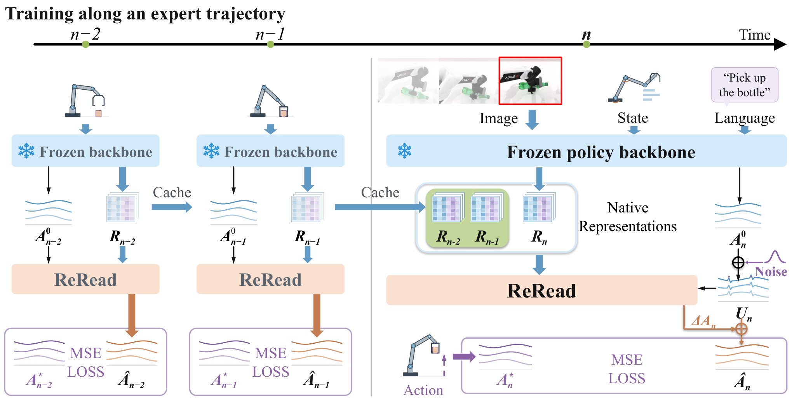

# ReRead: Wrong Predictions, Useful Representations - Correcting Frozen Robot Policies by Re-reading Their Own Representations

机器人策略给出错误动作，不一定意味着视觉表征没有包含正确动作所需的信息。ReRead固定策略骨干，训练一个读取当前和历史原生KV缓存的修正器，直接改动作片段。它把“没看到”和“看到了但读错”变成可干预的实验问题，也解释了为什么过去执行错的动作仍可能留下有价值的任务阶段信息。

[arXiv:2611.20465v1](https://arxiv.org/abs/2611.20465v1)，首次提交北京时间2026-11-16 11:33；全文18页，附录A—E覆盖实现、误差分解证明和实验明细。作者在文中给出[代码地址](https://github.com/tan2355/reread)，本次GitHub API返回404，不能确认公开可用。本笔记重点核对第3—9页与第11—18页；开环拟合、闭环成功和专门相位歧义实机实验分开讨论。

## 缓存中的信息怎样变成动作

设冻结骨干根据当前观测生成候选片段$A^0$。ReRead不再编码原图，而是保存骨干已经算出的视觉prefill KV和最后一次去噪的动作KV。当前决策加前两个决策构成默认记忆；每条记录附带机器人状态、时间锚点、已执行动作前缀，以及层、相机、模态和位置标识。过去动作可以错误，记录仍可保存“正在放下还是正在拿起”的线索。

*原文图2：按专家轨迹缓存表征并训练动作残差，候选扰动不改监督与缓存。*

原文第4页图2将训练按时间顺序展开：每次骨干前向只做一次，缓存跨决策保留；候选动作作为修正器查询，当前及历史表征共同提供证据，修正后的动作与专家片段比较。图中的候选噪声只扰动动作，不改记忆，也不改监督目标。这里没有跨决策反向传播，更不是把过去帧重新送入额外大视觉编码器。

第4—5页缓存构造可写为：

$$
B_{\tau li}=\operatorname{LN}(W_K\operatorname{sg}(K_{\tau li})+W_V\operatorname{sg}(V_{\tau li})+W_s s_\tau), \qquad \hat A=A^0+R_\phi(A^0,\mathcal M).
$$

$\tau$为缓存时刻，$l$为骨干层，$i$为token位置；$K,V$是原生注意力键值，$s_\tau$为机器人状态，$W$是可训练投影，LN为层归一化，sg阻断骨干梯度。缓存内容$B$加位置及时间标识构成交叉注意力键，值使用内容；$\mathcal M$是这些记录组成的记忆。$R_\phi$输出与候选同形状的残差，最终相加得到动作。输出头零初始化，因此训练开始时与原策略一致。

FastWAM实现读取第4、14、24、29层，保留pre-RoPE归一化表示，头部视觉池化为4×8、腕部4×4，每层64个视觉token及32个动作token。修正器有5层、宽1536、24头、FFN宽6144，共198.52M参数。它相对骨干开销小，却不能笼统称为几乎无参数的适配器；另一种骨干的缓存层与动作接口仍需重新接入。

训练使用RoboTwin全部50任务，20k步、全局批量1024，16张H800耗时约5.8小时，即92.73 GPU小时。默认候选32步、动作14维、每执行20步重规划，骨干20步去噪。只对手臂关节位置以0.2概率加标准差0.05的归一化噪声，不扰动夹爪和缓存；用有效动作掩码下的全片段MSE训练。历史丢弃使模型在缓存不足时也能工作。这些细节决定它学的是有记忆的动作读出，而不是任意动作平滑器。

## 错误读出与缺失信息怎样区分

作者用平方误差的条件均值分解建立解释。令$A^*$为专家动作，$Z=(A^0,\mathcal M)$为修正器能看到的信息，$m_Z=\mathbb E[A^*\mid Z]$，原策略风险为：

$$
\mathcal R_0=\mathbb E\|A^*-A^0\|^2 =\underbrace{\mathbb E\|A^*-m_Z\|^2}_{\mathcal K(Z)} +\underbrace{\mathbb E\|m_Z-A^0\|^2}_{\mathcal G(Z)}.
$$

第一项是给定这些输入仍无法区分的动作差异，第二项是现有动作偏离最佳读出的部分。平方损失下条件均值与残差正交，因此两项相加；最优修正为$m_Z-A^0$。若实际修正器将风险降为$\mathcal R_\phi$，定义$b_\phi=1-\mathcal R_\phi/\mathcal R_0$，则$\mathcal K/\mathcal R_0\le1-b_\phi$。这说明成功修正给原有信息的不足程度提供上界，不说明所有可能任务的缓存都充分。

加入历史也有对应解释：当前信息为$Z_c$、加入有序历史后为$Z_m$，其条件均值为$m_c,m_m$，最优风险下降为$\mathcal K(Z_c)-\mathcal K(Z_m)=\mathbb E\|m_m-m_c\|^2$。只要历史改变了对当前专家动作的判断，就有价值；历史当时生成的动作是否正确，并不出现在这个条件里。有限测试集上的估计仍有采样误差，而且动作MSE的分解不能直接换成闭环成功率保证。

第6页的留出开环评估取Hard11的22条轨迹、每条前20个有效步骤，MSE单位为$10^{-4}$：

| 条件 | 动作MSE |
|---|---:|
| 冻结FastWAM候选 | 19.74 |
| 只读当前缓存 | 7.61 |
| 当前加两个历史缓存 | 1.49 |
| 历史换成同任务其他轨迹 | 18.43 |
| 两个历史顺序互换 | 5.50 |

历史模型较候选误差下降92.45%，对应上界约7.55%；但替换历史几乎抹去收益，换序也显著变差，说明缓存内容及顺序确实重要。候选独立采样六次再取均值仅约3.52%改善，不能解释上述下降。动作KV单独使用的Hard11成功率81.09%，接近完整81.45%；只用视觉KV为80.55%，不用KV为75.82%，因此收益也不是简单多加一个动作网络。

## 历史带来收益的范围

Hard11按已发布FastWAM成功率选取最难的11个任务，占原失败约66.5%。所有修正器仍在全部50任务上训练，它不是11个未见任务测试。每种条件11任务×25回合×Clean/Random两设置，共550回合。

| 冻结骨干 | 原始Hard11成功率 | ReRead成功率 |
|---|---:|---:|
| LingBot-VLA | 50.00% | 73.45% |
| π0.5 | 30.36% | 43.45% |
| FastWAM | 73.45% | 81.45% |

全50任务的同实验配对FastWAM由90.73%到92.66%，提升1.93个百分点；不能把历史文献中的91.83%替换成这组配对基线。Hard11改善更大，正符合难任务集中诊断的设计，但不能只报最难子集然后暗示全基准同幅提升。

历史数量也不是越大越好：0、1、2、4条历史分别为78.55%、78.73%、81.45%、78.36%。在当前控制频率与训练配置下，两条历史最有利。四种外部视觉编码分支约78.91%—80.36%，均未超过81.45%；这只能支持本实验设置中原生缓存已够用，不能据此认定机器人感知研究没有价值。

作者专门设计了拿瓶、放瓶、开夹爪、返回等当前画面相近但阶段不同的任务。仿真成功从2%升至50%；真实Flexiv双臂平台每模型50回合，在1600步限额下从0/50升至18/50，即36%。替换为相反阶段历史会将动作推向另一阶段，提供了阶段信息影响决策的定向证据。真实测试只覆盖这一专门任务，而且修正后仍有64%失败，不能外推为通用长程任务已解决。

附录A在A100 80GB上报告端到端时延279.89→291.55ms，增加11.66ms，即4.17%；两个历史常驻约9MiB，临时缓存13.5MiB，额外87.84GFLOPs。我的分析是，这条路线适合已有昂贵VLA却怀疑动作读出或阶段辨识不足的系统：先测缓存是否可读出正确动作，再决定是否增加视觉编码或全面微调。对新传感器、严重观测缺失和骨干根本未编码的信息，ReRead的风险分解并未提供补救保证。
