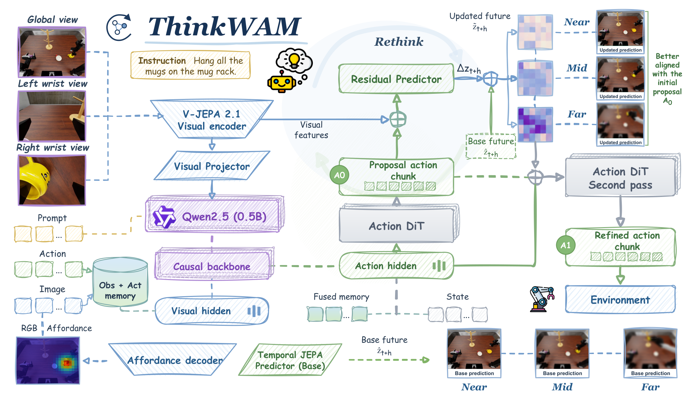

# ThinkWAM: Rethinking Latent Futures for Action Refinement

世界动作模型可以一边预测未来、一边输出机器人动作，但如果预测的未来完全不知道策略刚提出什么动作，它就很难检查这个提案是否合理。ThinkWAM让首轮完整动作片段修正多时域未来潜变量，再由同一个动作头生成第二轮可执行片段。它将动作与潜在未来连成部署时的反馈环，而不是在像素空间反复生成视频。

[arXiv:2611.21258v1](https://arxiv.org/abs/2611.21258v1)，首次提交北京时间2026-11-16 23:30。全文21页；第3—7页为方法和主要结果，第12—21页为实现、协议、消融及失败例。下面区分训练时未来监督、部署时两轮生成和真正的反事实预测，三者不能混为一谈。

## 先预测未来再用提案修正

从一个控制时刻开始：冻结V-JEPA 2.1视觉编码器处理当前画面，模型用当前视觉token和已执行动作历史重算16个记忆槽，再结合语言和机器人状态生成动作。这里的memory并非长时间保存的视觉记录；它的观测基础仍主要是当前画面和历史动作，因而无法无条件恢复已经消失的场景信息。

基础未来预测器在语言输入前的因果视觉前缀和基础记忆上工作，一次产生多个未来时域的潜变量。LIBERO使用第7、15、31步未来，分别分配288、144、72个token：近处保留细粒度，远处减少空间分辨率。它们直接并行预测，不是逐帧递归滚动，因此预测长时域不意味着已经模拟了每一步接触动力学。

*原文图2：基础未来只预测一次，提案修正潜变量后由共享动作头生成第二轮片段。*

原文第4页图2的关键是两种记忆路径与两次共享动作头。接触提示分支只改动作侧记忆，基础未来分支保持不变并只算一次。第一轮动作$A^{(0)}$通过残差网络修正未来，修正后的潜变量投影、归一化并加入第二轮条件；第二轮以新的高斯噪声重新生成动作$A^{(1)}$，只有后者执行。

$$
\Delta z_h=R_h(z_t,A^{(0)}),\qquad \tilde z_h=\hat z_h+\Delta z_h,\qquad A^{(1)}\sim\pi_\theta(\cdot\mid c_0,\{\tilde z_h\},q_t).
$$

$z_t$是当前视觉表示，$h$是未来时域，$\hat z_h$为基础未来，$R_h$为动作条件残差头，$c_0$为原始动作条件，$q_t$为机器人状态。这个式子在潜变量上加残差，最终动作由策略重新采样；它不是$A^{(1)}=A^{(0)}+\Delta A$。两轮共用动作DiT参数，每轮推理4个Euler步，训练首轮使用一个可微Euler步以传递梯度。

实际执行时先一次编码观测和基础未来，再首轮动作、潜在修正、第二轮动作，执行一定前缀后进入下个控制时刻。它没有搜索多条动作候选后按回报择优，也没有部署中的多轮收敛循环；论文只验证两轮。

## 监督、接触提示与模型边界

多时域JEPA监督来自未来真实图像的冻结编码器输出，目标停止梯度并归一化，用余弦形式对齐。每个时域等权平均，不能按token数量误读为近未来天然有更大损失权重。残差目标则保留未归一化特征的差值：

$$
\mathcal L_{\mathrm{res}}=\frac1{|\mathcal H|}\sum_{h\in\mathcal H} \operatorname{SmoothL1}\left(\Delta z_h, \operatorname{sg}\left[\operatorname{Pool}(E_v(o_{t+h}))-\hat z_h\right]\right).
$$

$\mathcal H$为预测时域集合，$E_v$为冻结视觉编码器，Pool将真实未来对齐到对应token布局，sg使目标不参与梯度。该目标让残差修正当前基础预测与专家轨迹未来之间的差异。由于训练主要看到专家动作，它并未单独提供任意错误提案作用后的真实反事实未来，不能把残差变化本身当作已验证的动力学模拟。

两轮动作都以同一专家片段做flow matching监督。给专家动作$A^*$、高斯噪声$\epsilon$和时间$\tau$，构造$A_\tau=(1-\tau)\epsilon+\tau A^*$，速度目标为$A^*-\epsilon$；动作损失是预测速度与目标的均方差。总目标为：

$$
\mathcal L=\lambda_0\mathcal L_{\mathrm{FM}}^{(0)}+ \lambda_1\mathcal L_{\mathrm{FM}}^{(1)}+ \lambda_J\mathcal L_{\mathrm{JEPA}}+ \lambda_R\mathcal L_{\mathrm{res}}+ \lambda_A\mathcal L_{\mathrm{aff}}.
$$

各$\lambda$控制两轮动作、未来对齐、残差和接触提示监督的贡献。实现时两轮都向共享动作头更新，不能只训练第二轮再声称复现。未来目标仅在训练需要，部署无需等待真实未来图像。

Affordance分支预测24×24软接触热图，用BCE加0.5倍Dice训练。置信度$\rho=2|p-0.5|$同时包含确信的正区域和负区域，不等于只筛选高接触概率区域；门控摘要以残差方式注入动作记忆。RoboTwin没有相应标签，明确关闭这一分支，因而该基准收益不能归于接触监督。

模型总量约1.507B，其中冻结视觉304.7M、Qwen2.5文本513.4M、共享动作DiT536.6M、辅助模块152.1M。训练使用4张A100 80GB与BF16；LIBERO两阶段各40k步，分别约75.4和116.5 GPU小时，RoboTwin90k步约211.7 GPU小时。论文的“无动作预训练”不排除视觉和语言预训练，比较时应保留这个定义。

## 收益来自哪里以及怎样比较

第5—7页及附录B给出四组基准，但统计范围不同。

| 基准 | ThinkWAM结果 | 关键协议 |
|---|---:|---|
| LIBERO | 98.70% | 40任务，每任务50初始状态，1974/2000 |
| LIBERO-Plus | 84.76% | 10030变体，七类别无权宏平均，微平均84.84% |
| RoboTwin 2.0 Clean / Random | 85.75% / 65.85% | 在50任务Clean示范上训练，只评固定20任务，各2000回合 |
| RoboCasa24 | 65.17% | 名义每任务50示范，评估每任务50回合 |

LIBERO-Plus沿用同一检查点，没有OOD微调；相机类别93.62%，但语言74.82%、纹理74.91%仍明显较低。RoboTwin的75.8%均值不能当作全部50任务结果。GO-1混合Clean和Random训练，PAVE还用Clean环境交互；RoboCasa比较也继承不同论文的示范数与预训练设置。作者透明列出了来源，但它们不是统一重训后只改一个组件的因果对照。

真机使用Galaxea A1Z。训练只见单个绿色物体，评测要求两个绿色物体全部放入盒子，另两条件分别加颜色干扰或紫光；三个条件都包含目标数量变化。每模型每条件30次，共90次，必须两次放置都成功才算整回合成功。

| 方法 | 双目标 | 加颜色干扰 | 加紫光 | 合计 |
|---|---:|---:|---:|---:|
| FastWAM | 14/30 | 9/30 | 11/30 | 34/90，37.8% |
| π0.5 | 20/30 | 15/30 | 16/30 | 51/90，56.7% |
| ThinkWAM | 22/30 | 17/30 | 19/30 | 58/90，64.4% |

这是同任务族中的数量与外观迁移，不是90项不同真实任务。ThinkWAM相对π0.5多7个成功回合，有限样本不能支持任意任务上的稳定优势。原文展示失败和去接触提示的定性例，但没有为每种真机组件给出同规模完整成功率消融。

最能解释机制的是LIBERO-Plus消融：

| 设置 | 成功率 |
|---|---:|
| 完整模型 | 84.76% |
| 直接执行第一轮提案 | 80.51% |
| 两轮但第二轮仍读基础未来 | 81.59% |
| 推理时置零affordance记忆残差 | 82.01% |
| 第一轮且无affordance残差 | 76.41% |
| 单一未来时域的独立训练版本 | 79.92% |

保留两轮但取消提案对未来的修正仍有损失，支持潜在反馈不只是额外采样开销；然而新的噪声和动作生成路径也变化，不能据此认定修正未来在真实物理上准确。置零接触提示是在完整检查点上推理干预，没有撤销其训练监督；单时域版本才另行训练，且用576个token近似匹配总量。因此不能将所有行都称为“从头去掉模块重训”。

单A100推理含视觉和两轮动作，LIBERO153.48ms、RoboTwin164.61ms；真机RTX4080 SUPER上为101.2ms。基线使用原生片段长度和10个积分步，ThinkWAM两轮各4步，LIBERO片段16步而一些基线32或50步。数值是每片段生成时延，不是每动作、每任务时间，也不是相同FLOPs下的速度优劣。

我的分析是，这项工作最值得复用的是“动作提案必须能影响随后被策略读取的未来条件”这一接口，以及显式区分基础预测与提案修正。下一步应以错误动作干预后的真实未来验证残差，并在相同采样预算下比较多提案重采样和多轮修正；这些仍是尚不能确定的问题。
