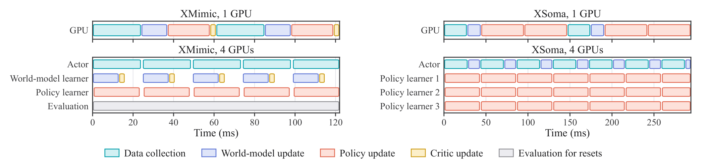

# XMimic and XSoma: Learning Humanoid Motion Tracking and Locomotion in Under a Minute

用世界模型训练机器人策略时，昂贵的未必是某个大网络，而可能是采样、模型学习、策略反传和重置评估必须依次完成。XMimic 与 XSoma 把这个执行链作为优化对象：短时域解析梯度减少样本需求，多GPU流水与专门的策略更新方式减少等待。论文的“一分钟”是在四张H100上达到特定仿真标准，不包含启动编译，也不是一分钟训练出已验证的真机策略。

Nico Bohlinger、Jan Peters；[arXiv:2611.20452v1](https://arxiv.org/abs/2611.20452v1)，首次提交北京时间2026-11-16 11:22。全文6页；主要方法和评测在第2—5页。[XMimic代码](https://github.com/nico-bohlinger/xmimic)、[XSoma代码](https://github.com/nico-bohlinger/xsoma)。

## 怎样让世界模型训练绕开串行瓶颈

PPO通过采样动作与回报估计策略梯度；世界模型路线则先学习状态转移，再沿预测轨迹把奖励梯度传回策略。它不是把真实模拟器变成完全可微系统，而是用可微预测器承担反向传播。模型偏差会随展开累积，因此这里只展开短轨迹，并不断用真实仿真采样更新模型和起始状态分布。

一条XMimic训练轨迹从回放缓冲区抽取状态开始。策略根据预测状态和参考运动输出动作，模型结合域随机化参数预测下一状态，奖励衡量运动跟踪，终止因子屏蔽失效后的贡献。第2页目标可写为：

$$
J(\theta)=\mathbb E_{s_0\sim B}\left[\sum_{t=0}^{H-1}\gamma^t c_t r(\hat s_t,a_t)+\gamma^H c_H V(\hat s_H)\right], \quad a_t=\pi_\theta(o(\hat s_t,g_t)),\quad \hat s_{t+1}=f(\hat s_t,a_t,\xi).
$$

其中$B$是回放状态分布，$H$是想象时域，$\gamma$为折扣，$g_t$为参考目标，$\xi$为域随机化参数，$o$构造策略观测，$f$为世界模型，$V$为末端价值估计。存活权重从$c_0=1$开始，按$c_{t+1}=c_t(1-d(\hat s_{t+1}))$累乘，$d$是终止判据。短展开后用价值函数补偿远期收益，因此既保留解析梯度，又不需要对整段动作序列反传。XMimic使用32步展开和SHAC式critic，而不是直接移除价值学习。

*原文图2：分卡执行的训练时间线，保留完整设备标签与流水依赖。*

上图来自原文第2页图2。时间线把不同设备承担的工作与等待关系放在一起：关键问题是缩短迭代关键路径，而不只是增大每次矩阵乘法。单卡顺序执行的核心时间近似为采样、世界模型学习和策略更新之和；分到不同GPU后，稳态吞吐近似由最慢环节决定。这里的并行同时引入陈旧参数：actor所用策略落后一轮，策略所用模型落后两轮。它是有代价的流水，不能理解为完全同步更新的免费加速。

实现使用JAX编译整个循环，包括MJX/MuJoCo Warp交互；前反向使用BF16，并预计算不依赖策略参数的噪声和参考项，将反向计算组织为更大、更少的矩阵操作。论文报告这些改动使策略更新较直接JAX翻译快约40%。BlinkMimic本身已使用CUDA graphs，所以不能把全部差异归因于“有编译”。

四卡版本分别承担采样、世界模型和critic、策略更新、重置评估。流水大约多需10%迭代，但吞吐约提高三倍。四张卡相对单张卡的壁钟收益，应同时报告其GPU使用量；作者明确指出总GPU时间没有随壁钟同比下降。

## XSoma为什么取消critic

运动跟踪的实现经验不能直接搬到粗糙地形行走。XSoma让世界模型只预测机器人动力学，足端高度、地形间隙、奖励与终止则由精确运动学及高度场计算。这样不用让网络额外学习已经有解析实现的几何关系，也减少脚部接触附近误差对目标的污染。

目标命令在一半想象轨迹起点重新采样，足端间隙与域随机化量进入世界模型输入。终止在前向仍是0/1硬判据，反向采用与间隙有关的sigmoid直通梯度。实现时必须区分前向判定与反向近似：后者给策略提供可用方向，并不证明硬终止本身可微。

这里32步展开不足以学稳，critic自举和不同$\lambda$回报尝试也导致慢或不稳定。作者最终将展开延长至48步，约覆盖50Hz控制下的一秒，取消末端价值项。式中的$V$项因此只属于XMimic，不能给XSoma照搬。更长的短期轨迹在这个奖励与地形设置下已覆盖足够的站稳与恢复过程，但尚不能推出长期任务都不需要critic。

XSoma的策略更新占单轮时间约70%。四卡设置让一张卡采样和学模型，三张卡分别计算不同起始批次的策略梯度，然后每个学习器依次应用三组梯度，而不是先平均成一个梯度。第二、第三组梯度相对已更新参数存在一到两步陈旧；论文实验中平均梯度反而较差。这是特定优化路径的经验结果，复现时需要保留应用顺序。

探索也有明确边界：一半环境采取确定性动作，而非全部加入噪声。全部噪声的对照即使训练45分钟仍会蹲伏，摔倒率最高约61%。因此快速训练不仅来自更快内核，也来自适合目标的动作采样与奖励配置。

## 一分钟的计时与硬件边界

动作跟踪使用LAFAN的40段动作、总长约2.5小时，机器人为仿真G1。达标要求归一化奖励至少0.82、没有失败动作段，并连续三个评估检查点满足条件。检查点每100轮评估一次；以下是第4页的训练分钟数。

| 方法 | H100数量 | 达标分钟 |
|---|---:|---:|
| BlinkMimic | 1 | 3.19 |
| InstantTrack v1.3 | 1 | 3.31 |
| XMimic | 1 | 2.47 |
| XMimic | 2 | 1.39 |
| XMimic | 3 | 1.09 |
| XMimic | 4 | 0.86 |

四卡XMimic相对单卡BlinkMimic的3.7倍是壁钟比；单卡对单卡的差距较小。BlinkMimic运行5次、InstantTrack 2次、XMimic单卡8次、其他卡数各4次，重复次数并不完全一致。实际工程决策还要看方差、分配卡数与编译摊销，不能只按最大倍数估算成本。

行走训练每10秒改变命令，每5—10秒推扰，并随机化质量、摩擦、PD参数和延迟；地形包括平地、粗糙地面和几厘米浅坑。评估每15秒保存检查点，用2048个20秒回合评估，线速度奖励至少0.95、偏航奖励至少0.8，同样连续三个检查点达标。

| 方法 | H100数量 | 达标分钟 |
|---|---:|---:|
| FastSAC | 1 | 9.44 |
| PPO | 1 | 60分钟内未达该标准 |
| XSoma | 1 | 2.50 |
| XSoma | 2 | 1.38 |
| XSoma | 3 | 1.02 |
| XSoma | 4 | 0.77 |

XSoma四卡相对FastSAC单卡约12.3倍，环境步数约为后者八分之一。论文还报告训练15分钟时速度误差比FastSAC训练到50分钟低约三分之一、摔倒率低于1%。FastSAC和XSoma四卡各8次、XSoma单卡5次、其余4次；PPO未达标对应的是本次较高阈值，并不表示PPO完全不能走。

主计时排除启动与编译：缓存命中约20—40秒，未缓存可能达3分钟，也排除离线检查点评估。这些开销与0.77分钟同量级甚至更大。对频繁改网络、改环境的小实验，应该同时记录冷启动端到端时间；对反复训练同一形状的任务，稳态训练时间才更有参考价值。

第5页结论明确说所有训练和评估仍在仿真，真实G1部署属于未来工作。我的分析是，最可迁移的贡献是测量并拆解训练关键路径，以及把解析几何留在模型之外；“无需critic”和陈旧梯度顺序应用是否仍适用于更陡地形、复杂接触和真实传感噪声，尚不能确定。
