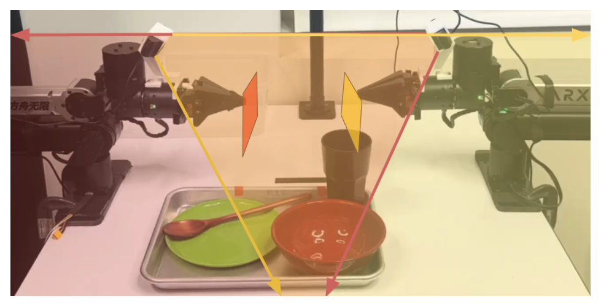

# ALOHA Lightning: Learning Fast and Precise Manipulation

把慢速示范训练出的策略加倍播放，往往会漏掉插入、抓取等关键瞬间。ALOHA Lightning先改变数据采集：人直接握住可反驱机械臂末端，在低延迟视觉、触感和声音反馈下做高速示教；再用几何遮罩消除操作员出现与否的视觉差异，用片段重叠平滑减少高速执行跳变。它是一套采集与控制配合的系统，而非只换一个策略网络。

John Hua Yao、Qi Wu、Yihuai Gao、Chelsea Finn、Zipeng Fu，Stanford；[arXiv:2611.21919v1](https://arxiv.org/abs/2611.21919v1)，北京时间2026-11-17首次提交。[项目页](https://flash-aloha.github.io/) · [代码](https://github.com/JohnYao93/flash-aloha)。全文8页，无附录；第4—7页为方法、对照与局限。

## 直接示教怎样改变动作分布

常见主从遥操作让操作者通过另一套设备间接感受机械臂运动；视觉、接触和运动约束的延迟会促使其减速。这里在双夹爪各装两个手柄，分别承托拇指与其他手指，并用绑带固定，让人直接反驱机器人执行。机械臂需要低摩擦与可反驱性，重力补偿按关节角和连杆质量在100Hz力矩控制中执行。高动态接抛球使用HESSIAN，其他任务用商业行星执行器机械臂，硬件条件不能忽略。

采集每秒50次同步三路360×640 RGB、关节位置和速度，两路腕相机朝夹爪中间，一路俯视。策略动作标签是未来关节位置而非某个遥操作设备发出的指令，低层PD再跟踪这些目标。人获得直接触觉不表示部署策略也有触觉输入；作者明确策略只有视觉与本体感知。

## 训练和执行如何对齐

直接示教产生的新问题是画面里有人手和手臂，部署时却没有。根据机器人描述、正运动学与相机/双臂间标定，可以计算手柄相对末端的位置，把人手附近四边形投影到各相机并置零。腕视角处理对侧操作者，俯视处理双手臂；训练和每一帧部署都施加同样遮罩。

*原文图3：遮罩随双臂末端位置更新，使采集和部署观察一致；该方法图用于解释几何预处理，论文未提供统一全流程架构图。*

图中的遮罩不是离线分割后补绘背景。它宁愿在两个域都删除同一区域，也不让策略依赖只在训练存在的人手；因此必须把标定和FK视为算法输入。代价是连同手边物体、接触位置等有用视觉线索一起删除，作者在结论中明确承认过于保守。

ACT根据处理后的三路图像与当前关节位置，预测未来一段目标关节序列。用概括形式，策略为$\pi_\theta(q_{t+1:t+T}\mid M(I_t,q_t,\mathrm{FK}),q_t)$，$T$为片段长度，$M$为三相机几何遮罩，$I_t$为原始图像。训练拟合未来关节轨迹，部署将预测片段交给PD控制，既保留了动作分块减少累积误差的优点，也引入相邻片段不连续的风险。

高速下很小的片段跳变会放大成错过抓取或插入力方向错误。新片段在旧片段结束前$H$步预测，与旧片段时间对齐，在重叠区混合：

$$
a_{t'}=(1-w(t'))\hat q^{(1)}_{t'+1}+w(t')\hat q^{(2)}_{t'+1},\qquad w(t')=\operatorname{sigmoid}\left(\frac{t'-(t+T-H)-H/2}{\sigma}\right).
$$

$\hat q^{(1)},\hat q^{(2)}$是前后两个片段对同一执行时刻的预测，$t'$是当前执行步，$\sigma$控制过渡陡峭程度。窗口前部主要信旧预测，后部转向新预测，非重叠区直接执行原始目标。这让策略不用每个控制步都重新推理，保留反应速度又缓和边界；它不保证整个动力学轨迹满足加速度或碰撞约束。

## 速度、精度与遮挡代价

每任务50条示范，五项双臂任务包括拔叠杯、电池插入、收桌、折短裤和接抛球。物体沿约15cm胶带随机摆放，短裤起始旋转约30度；属于有限工作台扰动，不是任意新环境泛化。论文报告总体任务成功率超过80%，具体速度见图1及第6页对照。

| 任务 | 直接示教策略完成时间 | 普通主从示教 |
|---|---:|---:|
| 拔叠杯 | 3.97秒 | 8.84秒 |
| 电池插入 | 5.70秒 | 17.87秒 |
| 收桌 | 6.81秒 | 16.05秒 |
| 接抛球 | 1.85秒 | 未完成该采集 |

这些数字说明该系统能学到远快于主从数据的动作节奏，但不是只控制网络架构的实验。任务本身、操作者与控制接口共同决定轨迹；也不能将图1单个时间标签当作跨全部条件的置信区间。

三个关键对照解释为何“快数据加平滑”比播放提速有效。首先，不遮罩时训练画面含手，部署缺手；扩散补绘又可能保留桌面手臂阴影并产生逐帧噪声。作者提出补绘伪影解释，但这是机制假设，未单独量化所有混杂。其次，无平滑的高速片段有明显跳变；逐步推理的时间集成虽可平滑，却增加推理成本并会混合已经应该转向的动作。作者关于即使更快硬件仍受平均轨迹影响的判断，也不能当作已做完该硬件对照。

最后，普通主从策略加倍控制频率，在拔杯、电池、收桌分别约5.47、12.90、9.30秒，仍较慢且精密任务性能下降；隔步跳过动作约5.58、10.30、9.29秒，可能跳掉压电池、合爪等关键动作。这说明采集到的动作分布和执行时间结构不能靠统一播放倍率替代。

用户研究让7名少或无经验志愿者在两套系统各熟悉3分钟，看专家演示后做10次电池插入；报告操作者时间差超过50%，部分可达三倍速度。它支持直接示教易上手，但样本很小，不能外推为所有人体条件和任务的人因结论。

我的分析是，这篇工作适合关注采集吞吐与高速执行的团队：应把示教器、视觉域对齐、片段切换和硬件跟踪误差一起评测。保守遮罩损失近手信息、缺少触觉，以及有限桌面任务分布仍限制接触复杂度；没有证据说明单纯移植平滑公式就能让其他平台达到同样速度。
