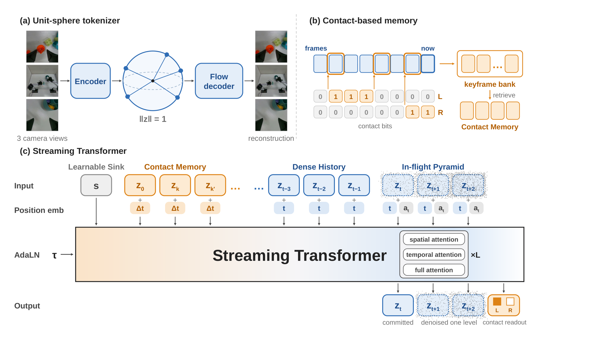

# DreamFAR: Real-Time and Long-Horizon Interaction with Diverse Objects

机器人把瓶子放进箱子后移开视角，普通短窗口视频世界模型可能忘记箱内已经有物体。DreamFAR将接触建立或解除的时刻作为记忆写入边界，再在末端返回相近姿态时检索对应画面。它结合流式去噪和单位球潜变量控制长展开漂移，但生成视频稳定与精确物理仿真仍是不同要求。

Yiming Dou等，Amazon FAR及合作高校；[arXiv:2611.22001v1](https://arxiv.org/abs/2611.22001v1)，北京时间2026-11-17首次提交。[项目页](https://www.yimingdou.com/DreamFAR/) · [代码](https://github.com/amazon-far/dreamfar)。全文14页，附录A在第13—14页；标题中的“从零”主要限定动力学，图像tokenizer使用预训练初始化。

## 接触为何成为长期记忆边界

一个观察时刻包含YAM双臂的三路256×256图像、14维关节状态及目标动作。图像被共享卷积编码器映射成每视图16×16个16维向量，每个位置做L2归一化。三个视图拼接、patchify后成为192个视觉token，加一个关节状态token，共193个token/帧。新帧和状态由动作条件动力学模型一起预测。

*原文图2：短期密集历史、接触关键帧和永久sink分别承担不同记忆职责；在途帧以错开的噪声级推进。*

模型保留5秒、50帧近期上下文，同时维护接触关键帧库。辅助头预测左右臂两个接触位，一侧发生变化就把该时刻画面写入库；检索从近期窗口之前的帧中，按末端位姿相似性和近因排序，保留初始锚点，共8个记忆槽。位姿来自预测关节状态的正运动学，帧使用相对时间偏移而非槽编号。

接触标签在训练时来自经过人工纠正数据微调的VLM，部署由自身预测更新，不能说没有任何接触监督。附录说明标签器看每臂8帧、5Hz片段，两次错位调用合到10Hz，再做三帧平滑和进入0.6、离开0.4的滞回。99.2%重跑一致率只是确定性，不是标签准确率；模型审查观察到接触起始相对合爪可能延迟0.03—0.38秒。直接用夹爪开合替代会漏掉非抓取接触，也是作者拒绝该替代方案的原因。

## 流式生成怎样限制漂移

设$x_t$为图像、$a_t$为动作，$h_k$包含此前图像与动作，则多步预测按因果分解：

$$
p_\theta(x_{t+1:t+K}\mid h_t,a_{t:t+K-1})=\prod_{k=t}^{t+K-1}p_\theta(x_{k+1}\mid h_k,a_k).
$$

$K$为未来步数。展开后$h_k$包含模型自己生成的画面，因此单步误差会反馈进入后续预测。短期窗口负责连续运动，接触帧负责已经离开视野的交互状态；固定8槽使注意力上下文不随展开无限增长，但关键帧库本身的存储与检索成本仍应单独考虑。

1.9B动力学Transformer有28块、宽2048、16头，逐块进行帧内空间和跨帧因果时间注意力，其中5块用联合时空注意力。一个可学习sink帧永不加噪、永不逐出，提供稳定注意力锚点。每帧独立采样flow噪声水平，已提交帧也带0.24上下文噪声；预测潜变量在解码与复用前重新投影到单位球，限制尺度漂移。这个约束不保证物体位置或接触力物理正确。

流式推理同时保持$P=16$个在途帧，每次调用推进所有帧一个去噪级，提交最旧帧、移走最旧上下文并加入新噪声。滚动KV缓存避免反复处理已提交上下文，得到10Hz吞吐；代价是动作到渲染画面有16步流水延迟，10Hz下约1.6秒。实时吞吐不能直接改写成100ms反应延迟。

tokenizer的flow解码器从噪声积分到图像，训练插值为$x_\tau=(1-\tau)x+\tau\epsilon$，目标速度是$\epsilon-x$，与一些动作flow从噪声到数据的时间方向相反。解码采用两步Euler，约14ms/视图帧；每回合复用同一噪声张量。46.1M编码器和50.3M解码器从SSDD初始化并联合微调，随后冻结；动力学使用256张H200训练六天，附录还说明主训练从同架构较早14.5k步检查点权重继续，不能把整个系统说成完全无预训练。

## 预测视频与可靠评测的距离

主模型来自内部机器人原生数据。公平比较另用公开ABC约131k回合、201任务、3500小时：DreamFAR与WEAVER约0.8B，IWS约0.4B以匹配流式步时，Cosmos-Predict 2.5也在相同划分训练。1000个留出回合先给15秒真实历史，再按记录动作自回归60秒。

| ABC一分钟预测 | 平均PSNR |
|---|---:|
| IWS | 11.0dB |
| WEAVER | 14.5dB |
| Cosmos-Predict 2.5 | 15.8dB |
| DreamFAR | 16.4dB |

DreamFAR的FID随一分钟从15到32，对比Cosmos从30到73。它支持长展开漂移更慢，不等于已经量化接触力、守恒或所有反事实动作的正确性。主1.9B系统和公开比较0.8B版本也必须分开。

接触记忆消融在整理调味瓶任务4.6k回合上，将短历史缩到1秒、记忆2槽，控制其他结构相同：

| 记忆 | PSNR | LPIPS | FID | DINO相似度 |
|---|---:|---:|---:|---:|
| 无 | 18.655 | 0.348 | 37.156 | 0.749 |
| 固定1秒间隔 | 18.988 | 0.334 | 36.438 | 0.767 |
| 接触事件 | 19.251 | 0.326 | 34.811 | 0.777 |

回看箱内时，无记忆会生成空箱，稀疏定时记忆可能生成错的瓶子，接触帧保留了放置后的状态。该消融支持事件选帧优于本设置的时间采样，但只覆盖一个任务，不能把改善全部归因于普适接触推理。

策略评估用π0的早期2.5k与后期15k检查点、三个任务，每个策略—任务组合各32次真实和模型回合。进度人工标注为完成比例，Pearson $r=0.71$来自六个组合均值，并非192个独立任务；只在三任务中的两项保持检查点排名，绝对进度普遍乐观。成功示范主导的数据分布也可能让模拟器低估失败。

生成数据实验只在把三袋薯片放入篮子的任务进行：75真实、75模型示范及合并150条，各训练π0，再各10次真实60秒测试。混合数据进度63%，约真实单独训练两倍；数量翻倍与来源改变同时发生，不能证明一条合成示范等价或优于一条真实示范。作者也明确不应把模型内评测作为真机部署唯一门槛。

我的分析是，最可复用的是把“场景结构改变”的事件变成记忆写入规则，并显式测量吞吐与反馈延迟。当前只覆盖YAM站、单一本体和平行夹爪；跨站点、灵巧手、失败分布与精确物理验证仍未解决。
