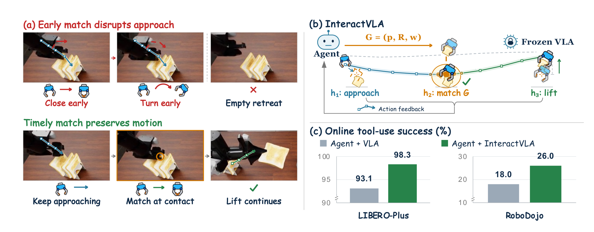

# InteractVLA: Turning VLAs into Interactive Tools for Agentic Robotic Manipulation

高层Agent只用语言调用VLA，失败后往往只能换句话重试。InteractVLA新增双向接口：Agent给末端位置、旋转和夹爪目标，冻结动作专家在生成中接受可微几何引导；生成的完整片段和相机重投影再返回Agent，用于改目标或局部修补。它改造工具的可控性与可诊断性，而不是直接更新VLA权重。

[arXiv:2611.22584v1](https://arxiv.org/abs/2611.22584v1)，北京时间2026-11-17首次提交。[项目页](https://lingwupro.github.io/InteractVLA/) · [代码](https://github.com/LingwuPro/InteractVLA)。全文10页，无独立附录；第3—4页方法，第5—8页实验。在线工具调用、递归自改进RSI和真机任务分数需分开理解。

## 目标怎样穿过动作专家

输入是当前观测、语言和目标$G=(p^*,R^*,w^*)$，分别表示末端位置、旋转及夹爪状态。冻结flow策略在生成时间$t$将噪声$x_t$逐渐变成动作片段，速度场为$v_\theta$。先用一步外推估计干净动作，再通过针对当前观测定义的可微命令到位姿映射$C_o$，得到每个执行步的完整位姿误差$E_h$。

*原文图2：过早合爪或转向会破坏接近动作；软时间匹配让目标在合适时刻达成，并向Agent返回轨迹。*

第3页生成更新的核心为：

$$
m_t=x_t+(1-t)v_\theta(x_t,t;c),\quad g_t=\nabla_{x_t}L_t(C_o(m_t),G),\quad x_{t+\Delta t}=\operatorname{sg}[x_t+\Delta t(v_\theta-B_t(g_t))].
$$

$c$为观测与语言条件，$m_t$为干净动作估计，$L_t$聚合各步位姿误差，$B_t$缩放并限制引导幅度，sg阻断跨积分步梯度。每一步只穿过当前动作专家求输入梯度，专家权重不变；其雅可比让局部目标同时影响片段其他动作。引导只在去噪内部窗口启用，保留端点原始速度场。

位置、旋转和夹爪误差按各自尺度归一化，双臂要求在同一个执行索引满足目标，避免左右手各自找到不同到达时刻。若首个引导步后的最小误差和相对修正需求显示目标不兼容，置信度低于$e^{-1}$就提前返回Agent重规划。这是启发式兼容性拒绝，不是碰撞安全证明；部署还需要可靠动作语义、运动学映射和相机标定。

## 为何不指定固定到达步

把目标强压到片段最后一步，会给不同速度的任务指定错误节奏；平均约束每一步又会将整个接近动作拉到目标。作者把到达索引视为潜变量，使用随去噪逐渐变尖的分配：

$$
q_h(t)=\operatorname{softmax}_h(-\beta_tE_h),\qquad \beta_t=\frac{t^2}{(1-t)^2},\qquad g_t=t(1-t)\sum_h q_h(t)\nabla_{x_t}E_h.
$$

$h$是执行片段内的动作步，$E_h$包含完整位姿误差。前期温和分配到多个可行到达时刻，后期聚焦最匹配的一步；$t(1-t)$限制端点幅度。实现应保留有限的内部引导窗口，避免将$t=1$处表达式直接用于数值计算。这一权重同时作用于位置、旋转和夹爪，防止过早合爪却把位置留到后来。

反向接口不只返回“失败”。Agent看到整段生成动作、执行前缀、剩余动作和观察历史，通过标定把3D命令重投影到图像，比较目标位置与实际运动。目标选错时重设$G$并再次调用VLA；动作结构正确时，局部修改接近偏移、抬升高度或松爪时间。几何引导与局部机器人工具因此都参与最终行为，不能把全部收益归为单一损失函数。

## 在线工具和RSI收益不能混算

基座为MR-0。在线工具实验用Sol；RoboDojo、RoboCasa365的RSI用Astra，LIBERO-Plus的RSI用Sol。练习环境保留任务语义、改变随机种子和布局，作者声称实际评估场景不暴露；这仍是有额外练习预算的系统，与零练习VLA不同。

| 设置 | LIBERO-Plus | RoboDojo |
|---|---:|---:|
| 独立MR-0 | 88.5% | 9.2% |
| 语言式Sol+VLA | 93.1% | 18.0% |
| 在线Agent+InteractVLA | 98.3% | 26.0% |
| InteractVLA+RSI | 99.4% | 48.62% |

静态训练参考目标在RoboDojo只把独立VLA整体提高到12.17%，精度从7.8%降到4.0%，长程从18.6%降到15.3%。这项负结果说明一个空间目标未必能解决接触与任务顺序，需要反馈闭环。在线Agent精度也从9.7%降到8.3%，不能声称所有维度都改善。

RSI的RoboCasa365为89.4%，Composite-Unseen84.8%。相关表包含来自既有论文的不同协议，LIBERO-Plus部分Agent基线在120变体分层子集，而不是全部方法统一重训同预算。最高99.4%不能直接解释为仅增加几何引导的收益，也不能把论文对更强模型的推测当作已做实验。

软时间消融在同VLA、目标与RSI预算下，RoboDojo固定末步39.1%、全步平均34.7%、硬最小44.2%、软分配48.6%；RoboCasa365分别83.0%、79.8%、86.1%、89.4%。反馈消融从仅观察40.3%、加入动作44.8%、再加重投影48.6%，支持接口两方向都重要，但尚无统计方差来判断小差异稳定性。

真机Dexmal有四任务，每任务50示范训练相同MR-0、每方法30次试验。表6报告的是平均任务分数，不全是二元成功率：

| 任务 | Agent+VLA分数 | Agent+InteractVLA分数 | 后者时间 |
|---|---:|---:|---:|
| 收拾桌面 | 65.5 | 92.5 | 295.8秒 |
| 扶正瓶子 | 37.9 | 74.6 | 217.1秒 |
| 倒水 | 38.5 | 79.2 | 71.2秒 |
| 方块入杯 | 86.7 | 97.6 | 67.5秒 |

这些时间比语言式Agent+VLA短，但仍明显长于一些独立VLA的单回合执行时间，后者分数又低。不能写成“所有方法中最低时延”。RSI成本图累加失败、重试、API和环境时间，是更合适的完整系统成本概念，也应与单次VLA去噪时延分开。

我的分析是，这项工作最值得复用的是完整几何目标与动作可视化反馈契约。其前提是可微动作专家、正确坐标与标定，以及允许反传的部署环境；仅有黑盒动作API的服务不能直接套用。下一步需要统一练习预算、测试子集、统计种子和安全约束，才能判断收益能否跨骨干和平台保持。
