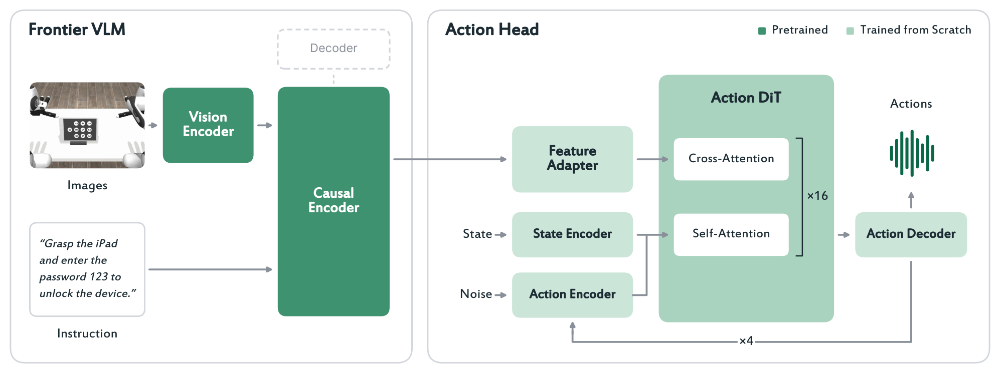

# ScaleVLA: Scaling Vision-Language-Action Models to 552 Billion Parameters

ScaleVLA研究的重点，是把前沿VLM的表示能力直接接到连续动作策略，而不在每个控制时刻生成文字推理。冻结552B骨干，只训练同一套动作头，再与2B—32B骨干比较，能看到预训练表示对少示范、场景扰动和精密插接的价值。不过，模型系列、预训练数据、输入token数和硬件同时改变，这项工作不能单独证明参数数量就是收益的原因。

Ruixi Yu等，清华、北大、上海交大及Galbot；[arXiv:2611.21607v1](https://arxiv.org/abs/2611.21607v1)，北京时间2026-11-17首次提交。[项目页](https://galaxygeneralrobotics.github.io/scalevla/)。全文19页，第18—19页附录包含解释数字所必需的归一化、计时和评测协议。

## 大模型怎样直接提供动作特征

一次控制输入包含相机图像、语言指令和机器人状态。DeepSeek-V4.1-Flash-1017是总参数552B的稀疏MoE；系统运行视觉编码与20层因果编码器，停在编码器—解码器接口，读取5120维视觉和文本token。后面的20层解码器不运行，没有自回归文字生成。总参数标签因此不同于每个token实际激活量，也不同于本系统真正执行的完整计算图。

*原文图2：深色为预训练骨干，浅色为从零训练的动作模块；四步动作生成重复使用一次骨干输出。*

第4页图2中，特征先经层归一化、两层线性投影到2048维，再过4层自注意力适配器。状态和带噪动作由本体专用MLP编码，动作位置与flow时间也进入网络。32层动作DiT交替进行状态—动作自注意力与读取视觉/非视觉token的交叉注意力，最后预测整段动作的速度场。比较不同骨干时动作侧结构、随机初始化和数据保持相同，只有输入投影宽度随骨干变动。

给专家片段$A$、高斯噪声$\epsilon$、时间$\tau\in[0,1]$，先构造$A_\tau=(1-\tau)\epsilon+\tau A$，训练目标为：

$$
\mathcal L_{\mathrm{FM}}=\mathbb E\left[\|v_\theta(A_\tau,\tau\mid Z,s,e)-(A-\epsilon)\|^2_{\mathrm{valid}}\right].
$$

$Z$为适配后的骨干特征，$s$为机器人状态，$e$表示本体；valid表示只统计有效时间步和动作维度。目标速度$A-\epsilon$对应噪声到示范的直线路径，部署从噪声出发用4步积分生成连续关节命令。骨干冻结，所以训练可以预计算特征，每次动作生成的4步也复用同一份表示，避免把大VLM重复执行4次。

LIBERO预测16步、执行8步后重规划；DexJoCo预测30步，通过带时间戳的缓冲异步替换片段。异步控制可以维持命令输出，却可能执行基于旧观测的动作。因此控制器频率不等于新观测到控制反馈的响应速度，仍需测量观测年龄与缓冲耗尽。

## 样本效率到底控制了什么

第5—8页用相同动作初始化、嵌套示范子集与固定5000优化步比较，目标是少数据下的固定预算表现。训练使用64张H200、全局批量640、seed42，LIBERO初始AdamW学习率$10^{-4}$、5%预热与余弦衰减。各策略只训练一个随机种子，多个测试回合不能代替训练方差。

| 指标 | 小骨干参考 | ScaleVLA |
|---|---:|---:|
| LIBERO四套件均值 | Cosmos 2B 90.7%，32B 94.0% | 96.1% |
| LIBERO-PRO三个设置均值 | 最佳小骨干31.3% | 45.1% |
| RoboCasa Gen-30 | 最佳小骨干25.6% | 30.7% |
| RoboCasa Gen-100 | 最佳小骨干45.6% | 54.9% |
| DexJoCo完整随机化 | 最佳小骨干22.1% | 24.4% |

LIBERO-PRO仍有超过一半回合失败，Object环境扰动下ScaleVLA31.2%还略低于32B参考32.4%。DexJoCo完整随机化的Assembly只有1.3%，不能把总体领先转述为灵巧协调已解决。LIBERO和PRO分别每套件50初始状态、每扰动设置500回合，均值是无权平均。

Goal上10条示范的87.8%超过2B用50条的85.6%，是论文醒目的数据效率结果。但第18页明确：示范预算只限制用于策略更新的轨迹，动作和状态1%—99%分位数归一化仍来自完整训练集。因此不能说策略完全只使用了10条数据的全部信息。

第19页延长训练的对照进一步限制结论：只有5条示范时，2B的Goal从5k步39.4%升到40k步69.6%；552B在5k步77.4%、20k步77.2%。Long上2B从24.0%升到55.2%，552B从62.2%升到71.8%。大表示在固定少步预算下有优势，但未在相同收敛标准与同等总计算下比较。“50条”示范扫描与主表全数据结果也不能互换。

## 真机收益与硬件成本

真机插充电器用303段数据：171段完整示范和132段插入片段，26段留作验证；40k训练步。三种方法同一动作DiT、相同安全限制，比较抓取、双手交接、插入并松手的整任务。

| 骨干 | 参考布局成功 | 空间扰动成功 | 成功回合完成时间中位数 |
|---|---:|---:|---:|
| Cosmos-Reason2-2B | 4/10 | 5/15 | 147.1秒 |
| π0.5表示加同动作头 | 8/10 | 7/15 | 132.0秒 |
| ScaleVLA | 9/10 | 8/15 | 114.4秒 |

改善集中在插入，ScaleVLA成功回合插入中位58.1秒，对比π0.5的81.2秒。不过每条件仅10或15次，π0.5与ScaleVLA只差一个成功回合，计时还条件于成功，不能作全任务期望时间或显著性声明。空间OOD也只有8/15成功。

RoboCasa客户端批量1、50次预热后3000次调用，ScaleVLA四H200中位215.8ms，对比2B单H200114.7ms；动作头约70ms。真实机器人端ScaleVLA却为384ms/片段，不能套用216ms。计时使用vLLM，而成功率使用Hugging Face部署，未逐元素比较两条路径的特征；小模型计时有并行任务，ScaleVLA来自更早一次运行，token数也不同。论文给出了这些限制，所以“276倍参数只慢1.9倍”必须连同硬件与读出截断一起理解。

我的分析是，最有价值的设计是把强表示与动作监督隔离，再用数据量、优化步和任务阶段分别诊断收益。后续应补相同预训练家族、相同输入分辨率、全子集归一化、多训练种子与统一部署路径的实验，才能更清楚解释表示规模本身的贡献。
