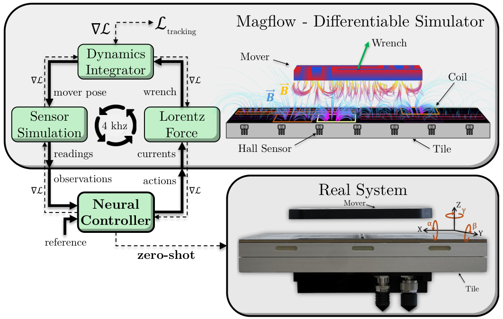

# Magflow: Differentiable Simulation of Industrial-Grade 6D Magnetic Levitation

磁悬浮控制的难点在于，悬浮体的运动改变磁场和线圈受力，而控制器必须在下一个极短周期内重新给出稳定电流。Magflow 把高保真的电磁计算放在离线训练侧，在部署侧只运行循环神经网络，由原始霍尔观测直接产生电流。它展示了工业平台上新的运动范围，也清楚暴露出范围扩展与精密定位之间的代价。

Philipp Hartmann、Jannick Stranghöner、Klaus Neumann；[arXiv:2611.23050v1](https://arxiv.org/abs/2611.23050v1)。本文依据八页全文；方法集中在第 2–6 页，真实平台比较在第 6–8 页。论文页首标注为 RA-L 已接受预印本；[项目页](https://sites.google.com/view/magflow)提供作者入口。本笔记没有本地运行控制器或复现实验。

## 为什么把电磁计算移到训练侧

在 XPlanar 系统中，带永磁体的 mover 悬在固定 tile 上方。定子线圈电流同时影响悬浮体受力和霍尔传感器读数，因此“先估计位姿，再算期望力，再换算电流”并非互不干扰的模块。传统共设计利用特定 Halbach 磁阵列和线圈几何，把换相近似成可实时计算的谐波关系。这种近似很有效，但大偏航角和改变磁体拓扑会超出其适用区间。

论文使用 240×240 mm 的 APS4322 tile 与带 20 块立方磁体的 APM4330 mover。50 个三轴霍尔传感器产生 150 维观测，24 组定子单元产生 72 个传统电流控制量。控制频率固定为 4 kHz，每周期仅 250 微秒。作者并不试图把精确电磁模型塞入这个周期，而是让训练期间的闭环展开包含完整物理，最后把稳定控制规律压入小型网络。

*论文原图编号：Fig. 1。上方闭环把霍尔模拟、神经控制、电磁受力和动力学积分连成计算图，下方说明训练后控制器向真实硬件迁移；虚线表示梯度与迁移关系。*

图中重要的是同一个网络既参与模拟闭环，又成为真实控制器。GPU 上的物理计算不是部署时额外需要的模块。所谓 zero-shot 指从模拟训练到对应真实平台时没有再用真实轨迹微调，并不表示一种策略可直接控制任意磁体：APM 偏航、条形磁体偏航、条形磁体偏航加翻滚分别训练了控制器。

## 从线段受力到闭环梯度

首先给定 mover 位姿 $p$，使用理想长方体永磁体的解析磁场 $B_m(p)$。霍尔观测可概括为

$$
o=c_{sens}\bigl(B_m(p)+Si\bigr)+\eta.
$$

这里 $o$ 为 150 维读数，$i$ 为 72 维定子控制电流，$S$ 是固定线圈到传感器的线性磁场映射，$c_{sens}$ 表示传感器量程缩放，$\eta$ 表示噪声。因为定子与传感器相对静止，$S$ 可以预计算；随位姿变化的永久磁体场则要每步计算。实现时若只模拟 mover 的磁场而漏掉 $Si$，策略会在训练中获得真实平台不存在的干净观测。

受力计算把四层铜线离散为 130368 个线段；每条导线横截面以五根平行细线近似，线段长度约 3 mm。对第 $\ell$ 段，Lorentz 力为

$$
f_\ell=I_\ell\,\Delta l_\ell\times B_m(r_\ell).
$$

$I_\ell$ 为该段电流，$\Delta l_\ell$ 为有方向的线段向量，$r_\ell$ 为采样位置。对所有导线受力求和，再用作用反作用得到 mover 的负合力；力矩还需乘相对质心的力臂。重力与外部扰动力另行加入。它保留了有限磁阵列、高阶谐波与交叉耦合，但仍依赖理想磁体和离散导线近似，并非无模型误差的电磁真值。

固定姿态下，六维 wrench 与控制电流是线性的，可写成 $w=A(p)i$，其中 $A(p)$ 为 6×72 矩阵。这一结构让电流方向的梯度直接取 $A(p)$，不必反向穿过整个线段求和。作者还将 $A$ 每四个控制周期更新一次，得到约 3.5 倍提速；报告的力误差约 0.5%、力矩误差约 0.8%。这些误差来自论文训练参考轨迹的验证，不能当作所有快速运动下的统一上界。

动力学采用 250 微秒半隐式 Euler 积分，旋转通过 SO(3) 指数映射更新，包含陀螺项、阻尼和 mover–tile 接触。这样一个电流输出经过受力、积分、传感器模拟后成为下一时刻输入，轨迹损失即可沿整个闭环回传。

## 电流表示为什么比网络大小更关键

网络为四层、每层 256 单元的 GRU。输入包含 150 维原始霍尔读数和八维参考：三维位置、三维法向以及对称性处理后的偏航正余弦。APM 磁体的四重对称使单帧观测不能区分所有绝对偏航，连续旋转依赖循环状态维持历史一致性。因而历史状态管理也是部署协议的一部分。

作者不用冗余的幅值、相位等多种参数同时描述同一三相电流，而输出 24 组二维 Clarke 坐标，共 48 维；幅值取二维范数，相位取 atan2，再映射回实际电流。这样减少了同一物理电流的多重表示，缓解反向传播中的梯度尖峰。网络的作用是从观测与参考直接决定电流，而不是只输出给已有位置控制器的外部目标。

训练使用长度 500 步的截断反向传播，相当于 125 ms。窗口间保留物理状态和隐藏状态，避免每个窗口都从静止悬浮开始；更长训练轨迹由课程逐步增加。16 个并行世界一半使用悬浮目标跳变、一半使用平滑随机六维参考，加入恒定扰动力和相关随机扰动，并随机化磁体、质量惯量、霍尔安装与电流动态等参数。AdamW 学习率为 $5\times10^{-5}$，梯度裁剪阈值 100；每个控制器在单张 A40 上训练约五天。这是显著的离线成本，不能只用 4 kHz 描述总计算开销。

轨迹损失把毫米位置误差和角度旋转误差组合，安全项同时抑制贴地、超过 33 A 的线圈电流、无有效覆盖线圈的耗电以及电流和 wrench 的二阶抖动。供电连续功率 140 W、短时 240 W 的限制通过平台的时间预算和降额逻辑处理。仅靠低平均跟踪误差不足以得到可部署网络，电流、功率和接触限制共同塑造了策略。

## 新运动范围与精度代价

真实部署运行在 C6030 工业计算机的 i9-9900K 单核实时环境，无 GPU；AVX2 优化后的最坏网络推理为 242 微秒。它落在 250 微秒周期内，但余量仅 8 微秒，复现时还需要核对平台实时调度和完整周期开销，而不能把任意 CPU 上的平均耗时当作达标。

范围扩展的证据包括：APM 在离 tile 中心的 15 mm 半径圆轨迹上完成 360 度偏航，行为克隆基线立即失效；100×30×10 mm 的普通 N48 条形磁体也能进行六维控制。条形磁体的 360 度翻滚偶尔触碰 tile，因此不能写成整个过程始终无接触。载荷实验展示了 1.3 kg 悬浮，但未建立该载荷下任意动态轨迹的额定能力。

在既有工程工作范围内，作者用 Vicon 测量 60 秒随机轨迹，中位速度约 33 mm/s。位置与角度均报告 RMS，比较结果为：

| 控制器 | x/y/z RMS（mm） | roll/pitch/yaw RMS（度） |
| --- | --- | --- |
| 专有控制 | 0.09 / 0.07 / 0.06 | 0.10 / 0.07 / 0.05 |
| 行为克隆 | 0.15 / 0.14 / 0.09 | 0.12 / 0.11 / 0.10 |
| Magflow 真机 | 0.34 / 0.30 / 0.14 | 0.24 / 0.25 / 0.26 |
| Magflow 仿真 | 0.31 / 0.24 / 0.15 | 0.19 / 0.21 / 0.22 |

这张比较支持“新范围和新拓扑可控”，同时反驳“全面超过工业专有控制”的宽泛解读。模拟与真实位置误差相差不到 0.06 mm，作者据此认为当前主要瓶颈更可能在控制器本身；我的分析是，这只在所测范围和轨迹下提供线索，不能证明模型对全部状态都精确。

## 复用时应保留哪些边界

最值得复用的是利用物理中的线性结构简化梯度，再让闭环优化承担传统换相设计的一部分工作。对其他执行器，先找可预计算映射和精确局部导数，往往比一开始加大网络更有针对性。该判断是方法启发，尚未由其他执行器实验证实。

论文当前仅验证单 tile、单 mover。多 mover 会使霍尔观测与电磁作用相互耦合，多 tile 还涉及边界切换；作者将其留作未来工作。磁体模型没有覆盖所有铁磁材料和退磁效应，接触也有简化。尚不能确定，在相同训练预算下改用强化学习、不同控制结构或更精确接触建模是否能同时改善范围与精度。复现实验应分别记录位姿追踪、功率约束、最坏周期延迟和失稳条件，而不能把一次稳定悬浮当作整个系统通过验证。
