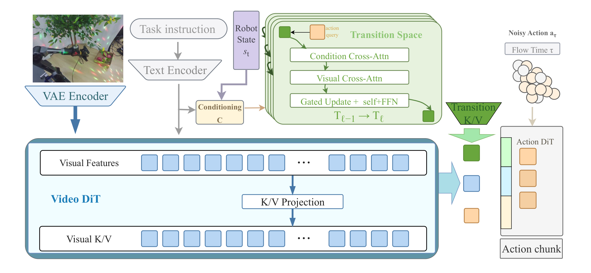

# Making Future-Predictive Representations Actionable

一个视觉表征可以预测未来，不意味着动作策略真的利用了其中的未来信息。RelayWAM 从这个区别出发：先诊断未来可解码子空间和动作敏感子空间的分离，再加入按动作查询、沿网络深度递归的过渡标记，把有用视觉线索接到原生动作注意力。它的证据比“加一个未来预测损失就有世界模型”更具体，也没有证明所有增益都来自预测信息。

[arXiv:2611.22994v1](https://arxiv.org/abs/2611.22994v1)。本笔记依据 15 页全文，含第 13–15 页 A–E 附录的探测、擦除、实现与评估协议；未本地复现。未确认作者公开代码和权重入口，不能据论文实验反推已开放可运行实现。

## 未来可解码为什么还不够

论文关注推理时不生成未来帧的 World-Action Model，简称 FFI。训练中加预测未来的损失，可能让视觉表示包含变化信息，但动作分支只需要从中读取少数任务相关线索。作者比较匹配骨干与数据的动作模型 A0，以及追加未来监督的 FastWAM A1，用 ridge 回归从各层特征预测未来潜变量差分 $\Delta z=z_{t+1}-z_t$，再分析动作损失梯度与视觉激活的乘积。

线性探测衡量“可以读出”，梯度敏感度衡量局部动作依赖，两者都不是完整的语义使用证明。作者发现深层动作更关注夹爪与物体，未来预测则包含更多背景；高能量梯度子空间逐步偏离。在动作敏感八维子空间里，未来可解码性相对全部特征的比值从浅层 0.77 降到中层 0.62、深层 0.57，30 个层中 24 个低于随机协方差匹配控制的 2.5% 分位。这支持接口存在错位，不能推出任何预测信息都没有参与动作。

为进一步检查，作者先从未来特征中回归掉真值动作和本体状态，再使用迭代零空间投影擦除剩余可线性解码未来的方向。擦除只作用于缓存的视觉 K/V，并限定四层窗口；视频分支不重新前向。100 个互不重叠 episode 上采用十步 flow，与相同秩和协方差的随机擦除配对比较，并做 1000 次 bootstrap。这样尽量避免把一般性的表示破坏当成“未来信息的因果作用”。

但结果并非所有层都对未来擦除无感。最深 26–29 层的归一化动作偏移为 1.06，随机擦除为 0.90；一些窗口的动作误差也会升高。这里的归一化基准是重新采样动作的噪声尺度。我的理解是，证据更适合说明未来表征的动作利用不充分且依赖层级，而不是证明未来监督完全无效。

## 把动作查询变成过渡标记

RelayWAM 保留当前帧 Video DiT 与 Action DiT 的原生耦合。在 30 层模型的第 14–29 层附加一个共享过渡模块，每个未来动作步对应一个过渡标记。它以当前带噪动作估计、本体状态、指令和 flow 时间作为查询条件，从不同深度的视觉特征提取动作相关信息，而不是直接要求动作头吸收全部视觉 K/V。

*论文原图编号：Figure 4。绿色过渡空间沿深度累计动作条件化的视觉读取结果，再投影成 K/V 接入 Action DiT；蓝色当前帧视觉 K/V 可缓存，过渡状态则随去噪步骤重新计算。*

给定语言和关节本体，先计算条件表示 $C$。在每个去噪步骤，以当前动作估计和前一层过渡状态构造查询，先跨注意力读取 $C$，再读取该层视觉特征，得到 $R_l$。其核心更新可写为

$$
T_l=\operatorname{TransBlock}_l\bigl(T_{l-1}+g_l(\tau)R_l\bigr),\qquad T_{13}=0.
$$

$l$ 为网络层，$\tau$ 为 flow 时间，$T_l$ 为该层过渡标记，$R_l$ 为条件化视觉读取，$g_l$ 为带 sigmoid 的时间相关门。TransBlock 包含动作步之间的自注意力和前馈层。加法保留此前深度积累的信息，门控制当前噪声阶段应读取多少；因此每一层无需从头猜测动作相关视觉状态。

随后将 $T_l$ 投影成过渡 K/V，使用归一化和动作步位置编码，拼入原生动作注意力的视觉、动作 K/V 序列，并通过路由偏置调节注意力。过渡模块的主要权重跨层共享，仅少量归一化参数依层变化，新增 34.96M 参数，相对 6.02B 主模型小于 0.6%。这个比例不是测得的延迟或显存增幅：动作去噪仍要运行新增读取与投影。

沿一次执行路径看，当前帧视频特征只计算一次并缓存，语言与本体条件也可缓存；每个 flow 步的带噪动作不同，所以过渡层需要从 $T_{13}=0$ 重新开始，在深度方向累计，最终修改本次动作去噪输出。这里的 recurrence 是层深递归，既不是跨真实时间的持久记忆，也不是显式展开反事实未来轨迹。推理时不生成未来图像这一点得以保持。

## 接口收益与预测监督怎样分开

训练目标仍为动作损失加加权未来损失，没有为过渡标记 新建额外预测监督。动作梯度通过接口回到视觉部分，目标是让已有预测信息更容易被动作读取。所有受控变体使用相同训练配置：八张 A100 80GB、20000 步、全局 batch 128，AdamW 固定学习率 $10^{-4}$。这使内部消融比跨论文排行榜更能检验接口的作用。

| 变体 | 未来监督 | 过渡接口 | LIBERO | LIBERO-Plus | LIBERO-PRO |
| --- | --- | --- | --- | --- | --- |
| A0 | 无 | 无 | 81.9% | 46.3% | 37.0% |
| A1 | 有 | 无 | 97.6% | 51.5% | 40.7% |
| B0 | 无 | 有 | 96.3% | 56.42% | 39.8% |
| B1 | 有 | 有 | 98.2% | 72.03% | 44.7% |

在 Plus 上，普通接口增加未来监督提升 5.2 个百分点，有过渡接口时提升 15.61 个百分点。这种交互支持“接口帮助利用预测监督”的解释。但 B0 没有未来监督仍明显超过 A0，说明动作条件化读取、架构容量或优化本身也有收益，不能把 B1 的全部增益单独归因于未来信息。尚不能确定更严格匹配新增结构但打乱未来内容时会怎样，这需要额外对照。

标准 LIBERO 在联合训练 40 项任务、每项 50 回合下得到 98.2%，低于表中的 OpenWAM 99.3%，因此论文并非所有基准第一。更值得关注的是分布变化评估，但也必须核对聚合方式与负结果。

## 汇总分数掩盖了哪些失败

LIBERO-Plus 的七类扰动回合数不同，72.03% 是全部评估回合的加权成功率，不是七列简单平均。背景 54.7%、相机 47.0%、语言 87.1%、光照 93.2%、布局 80.7%、机器人 61.6%、噪声 81.1%。对比 FastWAM 的加权 51.50% 有明显收益，但在背景、相机与机器人变化上仍有大量失败，也非每一列最佳。

LIBERO-PRO 五个轴平均为 44.7%，FastWAM 为 40.7%，表中 π0.5 为 53.2%。Task 轴从 2.3% 提升到 18.8%，Position 轴却只有 1.4%。这意味着模型仍不能依靠接口解决目标位置变化。不同论文若只报 PRO 的部分轴，不能直接拿其平均分与这里五轴平均排名；评测协议是数字的一部分。

真实实验为 Piper 机械臂在室内人工苹果树上采摘，80 条示范、训练十个 epoch，每个条件 20 次试验。在彩灯加随机变化条件中，RelayWAM 为 14/20=70%，FastWAM 为 3/20=15%；预训练来源不同的 DM.5 为 15/20=75%。这些结果支持该人工场景下的抗扰能力，但每条件只有 20 次，且并非真实果园。不能写成在自然枝叶、天气和长期运行中已验证。

## 更有价值的复现问题

我的分析是，方法的可迁移价值在于把“表示包含信息”与“决策可以访问信息”分开调试。可以先做可解码性探测，再用带随机控制的有限子空间擦除，最后测试动作条件化读取是否改善闭环。这比仅汇报未来重建质量更接近策略真正需要的证据，但擦除仍受线性空间、缓存干预和局部窗口的限制。

实际复现还应测完整动作片段时延、每步新增读写和缓存大小，而不只比较参数。过渡标记 随带噪动作改变，不能把整个过渡路径当作静态缓存。作者没有证明该接口在不同骨干、强遮挡或跨时间长期记忆任务上都成立；PRO 的位置失败也提示应分别评估空间定位和任务理解。下一步最有辨识力的实验，是在匹配参数、数据、更新预算与推理步数的条件下拆开未来内容、动作条件和深度累计三项贡献。
