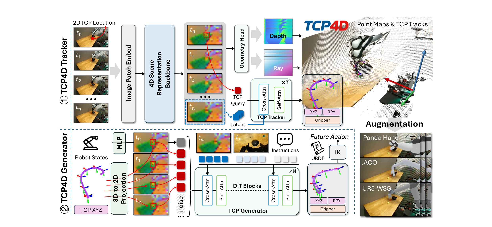

# TCP4D: A Unified Tool-Center-Point Tracking and Generation Model for Robot Manipulation

不同机械臂的关节与外观各异，但抓取操作最终都需要一个末端执行器在三维空间移动并开合。TCP4D 将工具中心点（Tool Center Point，TCP）的位姿和夹爪状态作为共同接口：先从视频恢复该接口，再在同一场景表征中预测它的未来，最后用目标机器人运动学执行或合成演示。理解它要同时看跟踪、策略和重定向三条证据，三者的成功率不能互换。

[arXiv:2611.23143v1](https://arxiv.org/abs/2611.23143v1)；[项目页](https://livioni.github.io/TCP4D/)。本笔记依据 34 页全文，含第 16–34 页 A–G 附录中的训练、数据、跟踪指标、增强和实机协议；没有本地训练或运行模型。

## 为什么把TCP设为共享接口

直接从图像跟踪一组夹爪表面点，需要把这些点重新拟合成刚体位姿；直接输出关节角则会绑定机械臂拓扑。作者使用 TCP 的平移、旋转与夹爪开合，把“图像中的运动”和“可以执行的动作”接到同一坐标接口。这里的统一是表示和模型结构上的统一，并不表示跨数据集只训练了一个无条件通用模型：DROID 与 RoboTwin 的第一阶段跟踪模型分别训练。

*论文原图编号：Figure 2。上方从视频和初始二维查询恢复场景及 TCP，下方将历史 TCP 局部特征与状态、语言结合生成未来轨迹，右侧通过目标 URDF 和 IK 进行增强。*

图中上方的初始二维 TCP 查询是重要前提。模型不是先从任意画面自动发现所有末端，而是由首帧中每个 TCP 的二维位置启动跟踪。单目图像与查询进入 DINOv2 基础的 4RC 时空骨干，图像 patch 之外加入相机标记和时间标记，通过帧内与跨帧注意力建立四维场景表征。Dual-DPT 几何头预测米制深度、相机射线及置信度，TCP 头利用初始查询附近 3×3 patch 和多个骨干层级，输出平移、连续六维旋转表示及夹爪状态。

跟踪推理默认九帧窗口，窗口间重叠一帧；把上一窗末端 TCP 投影到图像上，作为下一窗查询。这允许长视频处理，也意味着误差会通过查询传播。相机头被冻结且不参加训练；新场景中的相机外参误差并未因此消失。

## 轨迹监督怎样连接动作与重定向

为了让旋转误差落到有意义的空间约束上，作者在 TCP 中心及三个轴的正负 3 cm 处设置七个虚拟点。位置损失、旋转测地误差、预测置信度以及夹爪二元交叉熵共同训练跟踪；第一阶段还用速度一致性，时间反转片段保留时间戳符号。用几何点来监督姿态的直觉是：即便中心平移相同，转错方向也会移动轴端点，不能仅靠中心位置掩盖旋转错误。

两阶段目标可概括为

$$
L_1=L_{geo}+\lambda_{tcp}L_{tcp,1},\qquad L_2=L_{geo}+\lambda_{tcp}L_{tcp,2}+\lambda_{fm}L_{fm}.
$$

$L_{geo}$ 约束深度、射线及多尺度深度梯度，$L_{tcp}$ 约束末端姿态与夹爪，$L_{fm}$ 是未来动作的流匹配目标，$\lambda$ 为权重。第一阶段学习从视频读出动作相关几何，第二阶段保持几何与 TCP 监督并追加动作生成；时间速度项仅用于第一阶段。复现时若直接在第二阶段沿用所有第一阶段项，就改变了论文目标。

动作生成器读取四帧历史。把每个机械臂 TCP 在每帧投影回特征图并取 3×3 局部 patch，双臂共得到 72 个历史特征标记；14 维本体状态投影成状态标记。DiT 预测未来 32 步，每步双臂共 20 维：每臂三维位置、六维旋转和一维夹爪。12 层、宽 1280 的 DiT 对历史、状态和带噪动作做自注意力，再跨注意力读取当前场景、双腕 DINOv2-Large 特征及 T5-base 指令。推理用四个 Euler 步，位置按训练分位点归一化，旋转和夹爪使用各自约定。

这一路径解释了为什么几何表示能帮助动作：生成器的历史查询沿真实 TCP 轨迹采样，而非把整段画面无区别池化。它仍需要明确坐标约定。论文所有未来 TCP 都在相机坐标系表示，转换到机器人的控制系要依赖外参及运动学；这与评估时用真值做全局对齐是两件事。

重定向把恢复的轨迹转到世界坐标，使用目标 URDF 做逆运动学（IK），移除源机器人像素并渲染目标机器人。默认 auto_base 还会在初始 IK 不可行时搜索附近基座平移；基座朝向固定，而且要求所有帧均通过可行性检查。目标 URDF、初始二维查询、遮罩与修补质量都是实际前提，不能理解成任意 RGB 视频都可零标注变成可靠机器人接触数据。

## 对齐指标与泛化落差

第一阶段 DROID 使用 33966 个 episode、67932 个视角，按 episode 以固定种子划分 90/10，评估 100 个保留 episode。RoboLab 为只评估的 100 个 episode、覆盖 100 项任务，含成功与失败轨迹及随机视角背景。需要区分如下指标：

| 数据 | 原始 MPE（mm） | Sim(3) 对齐 ATE（mm） | 夹爪准确率 |
| --- | --- | --- | --- |
| DROID | 11.85 | 7.60 | 95.84% |
| RoboLab | 28.42 | 16.07 | 81.92% |
| UR5 少样本 3 示范 | 未在此汇总 | 12.22 | 未在此汇总 |
| UR5 少样本 10 示范 | 未在此汇总 | 8.85 | 98.48% |

MPE 保留原始米制误差；ATE 允许根据真值估计尺度、旋转和平移再对齐，所以更小的 ATE 不等于部署时可直接实现的绝对定位精度。APD 也使用真值的全局尺度调整。跟踪 SR=100% 代表窗口产出了有限、有效结果，不是操作任务全部成功。失败基线窗口计入 SR，却被排除在其误差统计外；点跟踪基线还使用 CAD/URDF 信息和不同窗口协议，因此单看误差排行不足以概括公平性。

RoboTwin 第二阶段以 48 项任务、每项 50 个干净示范训练，共 2400 个；另外两项 TCP 完全遮挡的任务被排除。每项以 100 回合评测：干净训练到干净测试为 **69.19%**，干净训练到随机测试仅 **10.94%**。后者低于论文表中若干基线，说明共享四维表征没有自动解决视角、外观和布局变化。RoboLab 相机平移误差达到 129.80 mm，也提示外参是重定向环节的现实风险。

真实 CoBoT Magic 在插笔与叠碗两项任务各使用 60 个示范、每模型每任务 30 次试验，通过 cuRobo 求 IK。TCP4D 成功率为 25/30=83.33% 与 22/30=73.33%，均值 78.33%；DP3 为 63.33%、ACT 为 31.67%。同时报告的平均任务分数 3.5/4 是分步进度，不应替代二元成功率。证据支持这两项实机任务的有效性，没有覆盖广泛本体或灵巧手。

## 99.25%和41.5究竟说明什么

作者将四项任务各 50 条 Aloha 演示增强到 ARX 和 UR5，分别有 199/200 和 198/200 通过生成，合计 397/400=99.25%。这个指标衡量生成管线通过率，不衡量增强机器人实际完成任务的比例。IK 可行也不能保证接触动力学、遮挡修补和物体运动都物理一致。

下游 Diffusion Policy 从头训练，以相同 epoch 数比较。ARX 使用增强数据单独训练的平均成功率为 30.5%，联合三本体数据为 72.0%，差值是 **41.5 个百分点**；UR5 为 32.0% 到 39.0%，增加 7 个百分点；源 Aloha 为 53.5% 到 65.5%。这些是四任务汇总，每任务评估 50 次，训练仅使用一个随机种子。相同 epoch 对更大数据集意味着更多梯度更新，因此联合数据收益并未完全隔离数据内容与优化预算，摘要里的“41.5%”不能改写成严格相对增益。

## 复现最应优先核对的接口

我的分析是，这篇工作最实用的贡献在于让跟踪、动作和跨本体增强共用可检查的末端接口。复现时可先在短视频上逐步检查二维查询、原始米制位姿、相机到世界转换、目标 IK 与渲染合成，然后再训练策略；若只看对齐轨迹图，最容易漏掉部署坐标误差。

作者的实验主要围绕平行夹爪，并依赖可见 TCP。对于严重遮挡、复杂接触以及形态差异更大的末端执行器，尚不能确定该接口是否足够。更有解释力的后续实验应固定梯度更新数、重复多个训练种子，分别干预跟踪误差、外参误差与合成图像质量，再看闭环任务成功率。论文当前的负结果已经表明：轨迹能被恢复、增强能被生成、策略能在随机环境稳定执行，是三个需要分别验证的环节。
